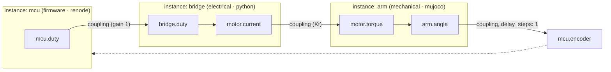

# Core concepts

Five ideas cover almost everything in a project file.



## Signals

A **signal** is a named, typed value that lives on the shared bus: `arm.angle`, `motor.current`, `mcu.duty`. It has a domain, a unit, an initial value and optional limits.

```yaml
signals:
  motor.current: {domain: electrical, unit: A, initial: 0.0}
  mcu.duty:      {domain: firmware, initial: 0.0, min: -1.0, max: 1.0}   # clamped when written
```

Besides `continuous` (the default) signals can be `discrete`, `event` (published with a time stamp, e.g. CAN frames or UART lines) or `bus` (structured payloads). A value may carry its unit (`initial: 25 degC`, `step: 0.0005 s`); the unit is recorded with the value.

!!! warning "Write values in SI base units"
    Units are recorded, **not converted**: `0.5 ms` is read as the number 0.5 with unit `ms`. Write times in seconds,
    lengths in metres and so on (`step: 0.0005`, `step: 5.0e-4 s`).

## Instances and adapters

An **instance** is one running simulator: a Renode machine, an ngspice circuit, a MuJoCo model, a Python plant, an FMU. Each has a name, a domain and a `backend` that selects the **adapter**: the small class that translates between signals and the simulator's own interface.

```yaml
instances:
  bridge:
    domain: electrical
    model: "embeddyn.mechatronics.plants:HBridgePWM"
    options:
      backend: python
      inputs: {in1: mcu.in1_duty, in2: mcu.in2_duty}     # plant input  <- signal
      outputs: {duty: bridge.duty}                        # plant output -> signal
```

Older projects use one instance per domain under `simulators:` (named after the domain); both forms can be mixed.

## Couplings

A **coupling** copies one signal into another every step, through an optional transform:

```yaml
couplings:
  - {source: motor.current, target: motor.torque, gain: 0.08}             # Kt
  - {source: arm.angle, target: mcu.encoder_counts, gain: 1303.8, delay_steps: 1}
  - {source: sensor.raw, target: mcu.adc, transform: {type: quantize, gain: 0.0008}}
```

Transforms are `affine` (gain, offset), `deadband`, `quantize` and `clamp`, each with optional `min`/`max`. `delay_steps: 1` reads the value committed at the end of the previous step. That is how feedback loops are closed without an algebraic loop (see [the master algorithm](../theory/master-algorithm.md)).

## The macro step

Everything advances in **macro steps** of `step_seconds`. Step *k* ends at exactly \(t_k = k\,h\) (an integer index, so no rounding drift). An instance can take smaller steps inside a macro step (`step: 0.00025`) as long as they divide it. Within a step, instances run in a fixed order: firmware, electrical, mechanical, thermal, environment, then declaration order. Couplings into an instance are applied just before it runs.

## Parameters

**Parameters** are named numbers with units and provenance, used by plants (`"@motor.resistance_20c"`), firmware bindings (written into RAM every step) and the analysis tools. Tuning, tolerance and estimation all work by overriding parameters, and every run records the resolved values in its manifest.

```yaml
parameters:
  firmware.kp: 26.7
  motor.resistance_20c: {value: 2.0, unit: ohm, provenance: [{source: datasheet, part: "XYZ-42"}]}
```

## Putting it together

| You want to… | You add… |
|---|---|
| run real firmware | an instance with `backend: renode`, a `.resc` script and bindings ([Tutorial 4](../tutorials/rc-servo-firmware.md)) |
| model a circuit with switching | a `backend: ngspice-shared` instance and a netlist ([Tutorial 2](../tutorials/ngspice.md)) |
| add gravity, joints, contacts | a `backend: mujoco` instance and an MJCF file ([Tutorial 3](../tutorials/mujoco-arm.md)) |
| score a run | `metrics:` ([Tutorial 7](../tutorials/tuning.md)) |
| check the model | `verification:` ([Tutorial 10](../tutorials/verification.md)) |

The full key-by-key description is in the [project file reference](../reference/project-file.md).
