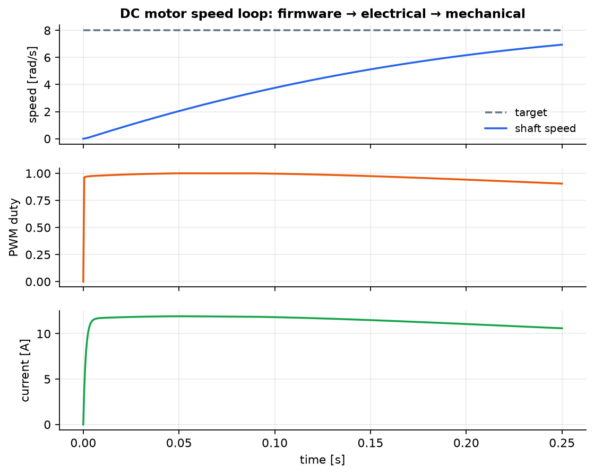

# Your first simulation

The DC motor example closes a speed loop across three domains: a PI controller (firmware), the armature circuit (electrical) and the rotor (mechanical). With `--mock` all three are built-in models, so it runs anywhere.

## 1. Validate the project

```bash
embeddyn mechatronics validate examples/mechatronics/dc-motor.yaml
```

```json
{
  "valid": true,
  "name": "dc-motor-speed-control",
  "schema_version": 1,
  "signals": 19,
  "couplings": 4,
  "scheduler": "deterministic-fixed-step"
}
```

Validation parses every value with its unit, checks that couplings and metrics name declared signals, that instance names are unique, that every step size is positive and divides the macro step, and that the scheduler settings are consistent. It does not start any simulator.

## 2. Run it

```bash
embeddyn mechatronics run examples/mechatronics/dc-motor.yaml --mock -o dc-motor.csv
```

The command prints a JSON summary: the run id, where the telemetry and manifest went, the final value of every signal and the project's metrics.

```json
{
  "project": "dc-motor-speed-control",
  "run_id": "20261124T113949833234Z-ae906a08",
  "steps": 501,
  "csv_export": "dc-motor.csv",
  "manifest": ".embeddyn/runs/20261124T113949833234Z-ae906a08/manifest.json",
  "final": {"time": 0.25, "mechanical.velocity": 6.946, "electrical.motor_current": 10.59, "...": "..."},
  "metrics": {"speed.final_value": 6.865, "speed.iae": 0.966, "speed.overshoot": 0.0, "...": "..."}
}
```

501 rows: the initial state plus one row per 0.5 ms macro step over 0.25 s.

## 3. Look at the result

```python
import csv, matplotlib.pyplot as plt
rows = list(csv.DictReader(open("dc-motor.csv")))
t = [float(r["time"]) for r in rows]
plt.plot(t, [float(r["mechanical.velocity"]) for r in rows], label="speed")
plt.plot(t, [float(r["firmware.target_velocity"]) for r in rows], "--", label="target")
plt.legend(); plt.show()
```



The duty saturates at 1 for the first ~0.15 s: the motor cannot reach 8 rad/s within the 0.25 s window at 24 V, which is why `speed.rise_time` is `null` (never reached) rather than a number.

## 4. What was written

| Path | Content |
|---|---|
| `dc-motor.csv` | one row per macro step, one column per signal (`-o`) |
| `.embeddyn/runs/<run_id>/manifest.json` | project hash, resolved parameters, adapter versions, timings |
| `.embeddyn/runs/<run_id>/signals/telemetry.jsonl` | the same signals as a stream (also readable while running) |
| `.embeddyn/database/metadata.sqlite3` | run index for `runs-list` / `runs-export` |

## 5. Try changing something

```bash
# A stiffer controller, without editing the file
embeddyn mechatronics run examples/mechatronics/dc-motor.yaml --mock \
  --parameter-overrides '{"controller.kp": 2.0, "controller.ki": 5.0}'
```

```bash
# The same project, interactively, in the browser
embeddyn mechatronics gui examples/mechatronics/dc-motor.yaml --open
```

Next: the [core concepts](concepts.md) behind that YAML file, or straight to [Tutorial 1](../tutorials/dc-motor.md) which takes the example apart line by line.
