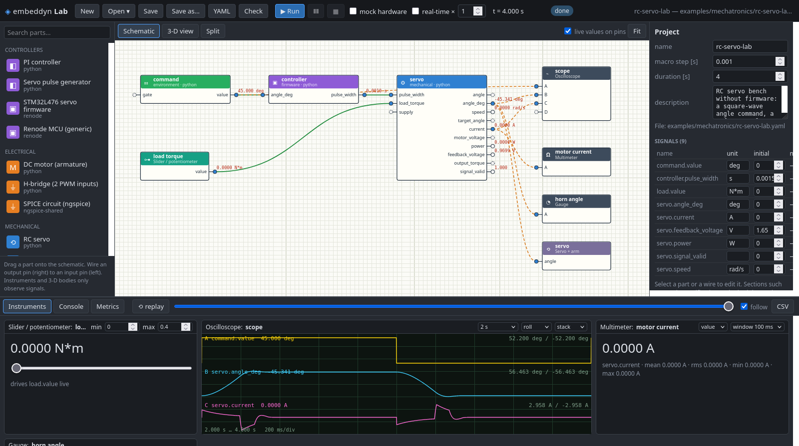
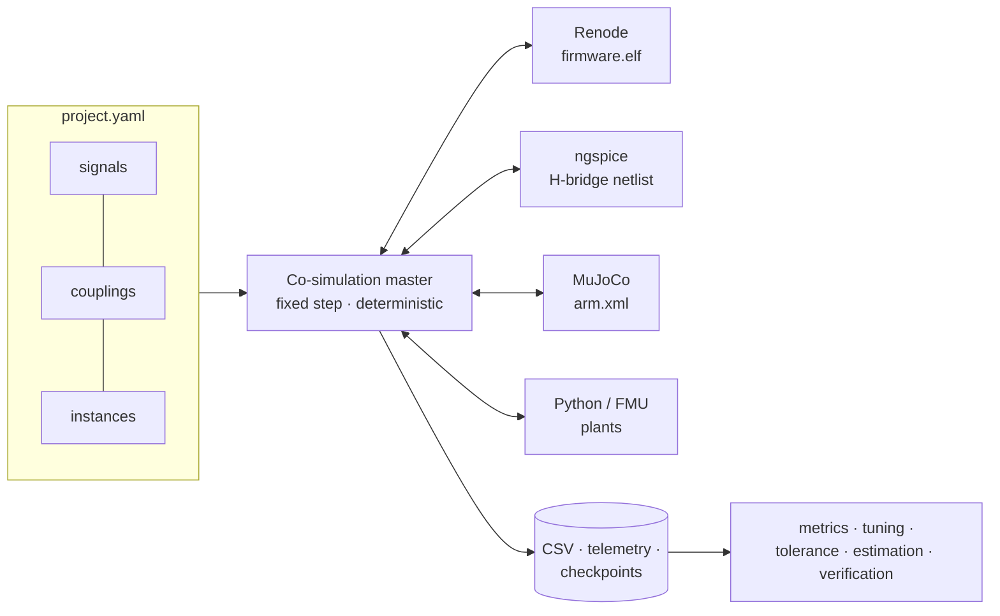
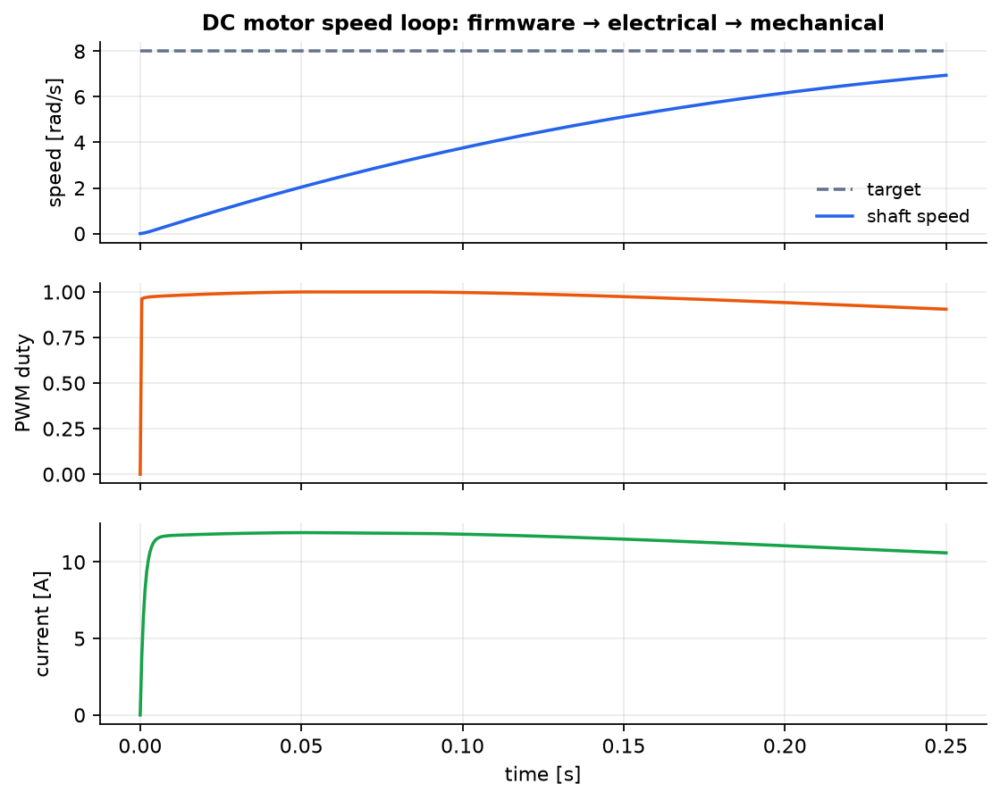

---
hide:
  - navigation
---

<div class="hero" markdown>

# embeddyn

<p class="lead">Emulate, test and tune a whole embedded system — the real firmware, the electronics around it and the mechanism it moves — in one deterministic co-simulation.</p>

[Get started](getting-started/index.md){ .md-button .md-button--primary }
[Tutorials](tutorials/index.md){ .md-button }
[How it works](theory/index.md){ .md-button }

</div>



## What it does

embeddyn runs each part of a product in the simulator best suited to it and keeps them in lock-step:

| Domain | Simulators | What you get |
|---|---|---|
| **Firmware** | [Renode](https://renode.io) (unmodified ELF on an emulated MCU) | the real control code, its timers, PWM, ADC, GPIO, UART, CAN, SPI and I²C drivers |
| **Electronics** | ngspice (shared library, state kept across steps), Python circuit models, FMUs | switching bridges with real ripple, supply sag, sensor front ends |
| **Mechanics** | MuJoCo multibody, Python ODE plants, FMUs, Webots | gears with backlash, friction, joints, gravity, contacts |
| **Thermal / environment** | Python plants, FMUs, recorded data | winding heating, derating, ambient profiles |

On top of a run it can **measure** (step-response, statistics and energy metrics), **tune** parameters with Nelder–Mead or CMA-ES, compute **yield and Sobol sensitivity** under component tolerances, **estimate** physical parameters from bench recordings, and **verify** a model (energy balance, step-size convergence, golden waveforms, scenario matrices). The **Lab** is a browser GUI with a schematic editor, virtual instruments and a 3-D view on the same project files.



## Where to start

<div class="grid cards" markdown>

- :material-rocket-launch: **[Getting started](getting-started/index.md)** — install, run the first example, learn the five concepts everything else builds on.
- :material-school: **[Tutorials](tutorials/index.md)** — eleven step-by-step lessons from a DC motor loop to an STM32 arm joint with SPI and I²C sensors, tuning and tolerance analysis.
- :material-cog-outline: **[Theory of operation](theory/index.md)** — how the master algorithm, the adapters and the analysis methods work, with the equations.
- :material-tools: **[How-to guides](guides/index.md)** — short recipes: a new plant, a new SPI sensor, firmware bindings, parallel runs.
- :material-book-open-variant: **[Reference](reference/index.md)** — every project-file key, CLI command and adapter option.
- :material-view-dashboard: **[Platform](user/README.md)** — the wider embeddyn Studio: Zephyr builds, RF/EMC, HIL, digital twin.

</div>

## A taste

```bash
embeddyn mechatronics run examples/mechatronics/dc-motor.yaml --mock -o dc-motor.csv
```



Every figure in this documentation is produced from a real run of the examples in `examples/mechatronics/` by `tools/docs/make_figures.py`; see [Rebuild these docs and figures](guides/docs.md).

!!! warning "Engineering simulator, not a safety case"
    embeddyn helps you find problems early and tune before hardware exists. Validate models against measurements before
    using results for thermal, current, force, lifetime or human-safety decisions.
