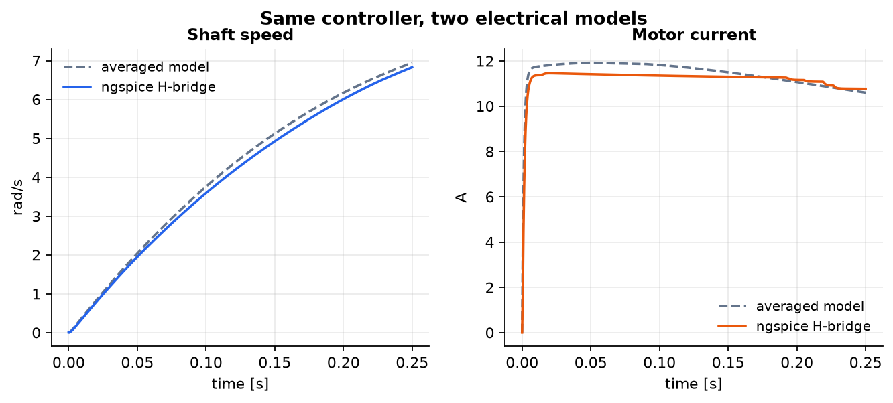
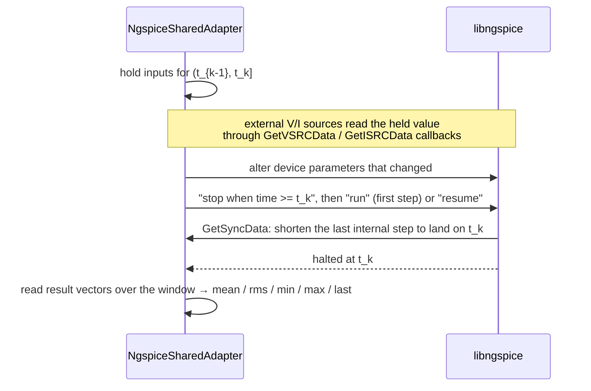

# Electronics

The electrical domain can be modelled at three levels of detail. All three expose the same signals (duty in, current and voltage out), so a project can move between them without touching firmware or mechanics.

| Level | Backend | What it resolves | Typical cost per 0.25 s |
|---|---|---|---|
| **Averaged ODE** | `python` (`DCMotorRL`, `HBridgePWM`) | \(L\,\dot i = d\,V - R\,i - K_e\,\omega\) | milliseconds |
| **Switching circuit** | `ngspice-shared` | every PWM edge, ripple, dead time, supply sag, diode recovery | ~5 s (250 000 SPICE points) |
| **Vendor-model validation** | `ltspice` / `ngspice` batch | one process per step, no carried state | slow; for checking, not loops |

*Same controller, same mechanics. The switching bridge delivers less current at full duty (supply resistance and switch losses), so the motor accelerates slightly more slowly.*

## Averaged models

`DCMotorRL` integrates the armature equation with the duty held for the step (zero-order hold):

\[
L\,\frac{di}{dt} = \operatorname{clamp}(d, -1, 1)\,V_s - R\,i - K_e\,\omega, \qquad \tau = K_t\, i, \qquad P_\text{in} = d\,V_s\, i .
\]

This is the right model whenever the PWM frequency is far above the electrical and mechanical bandwidths, which is most motor-control tuning. It runs in the [Python plant adapter](mechanics.md#python-plants) with RK4 sub-steps.

## ngspice in the loop

The `ngspice-shared` adapter loads **libngspice** into the process and runs **one transient analysis for the whole co-simulation**, pausing and resuming it at every step. Inductor currents, capacitor voltages and switch states therefore carry over between steps, which a process-per-step SPICE run cannot do.

### One electrical step

* **Inputs** reach the circuit through `external` sources (`Vdrive n+ n- dc 0 external`): ngspice calls back into the adapter for their value at every internal timestep, and the adapter answers with the held input. Device parameters (a resistance, an inductance) change through `alter`, sent only when the value changes.
* **Exact landing.** SPICE chooses its own timesteps. The sync callback shortens the last one so the analysis stops *exactly* at \(t_k\), not somewhere after it. An RC test checks the stepped response against the analytic solution to \(2\times10^{-4}\) V at every step.
* **Outputs** are reduced over the window \((t_{k-1}, t_k]\): the time-weighted **mean** (the default; what a slower domain should see from a 20 kHz ripple), `rms`, `min`, `max` or `last`.

\[
\bar{x}_k = \frac{1}{t_k - t_{k-1}} \int_{t_{k-1}}^{t_k} x(t)\,dt \approx \frac{1}{h}\sum_j \frac{(x_j + x_{j+1})}{2}\,(t_{j+1}-t_j)
\]

### Netlist preparation

The netlist is plain SPICE. Before loading, the adapter replaces `{{signal.name}}` placeholders with initial values, strips analysis cards (`.tran`, `.op`, `.control`, `.end`) and appends its own `.tran <max_step> <duration> uic`. `max_step` defaults to \(h/50\); a 20 kHz carrier wants \(\le 1\,\mu s\).

### Why mean values are the right coupling

The mechanical domain integrates torque over the macro step. Feeding it the step-mean current gives the correct impulse \(\int \tau\,dt = K_t \int i\,dt\) regardless of ripple phase; feeding it the end-of-step current would alias the 20 kHz ripple into a spurious low-frequency torque. The same argument applies to input power for energy balances.

## Circuits from KiCad

`embeddyn mechatronics kicad-export board.kicad_sch -o board.cir` calls `kicad-cli sch export netlist --format spice`. Mark the sources the co-simulation drives as `external` and map them in a bindings file; see [Export a KiCad schematic to SPICE](../guides/kicad.md).

## Limits

* libngspice is a process-global library: **one ngspice-shared instance per process** (use `--isolate-adapters` for more).
* All result points are kept in memory for the run.
* No checkpoint/restore of the SPICE state.
