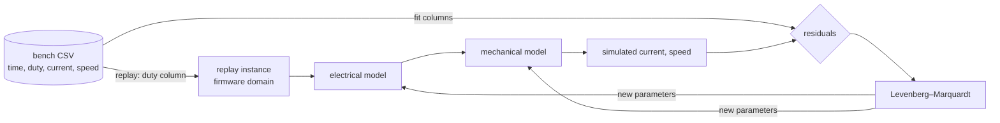
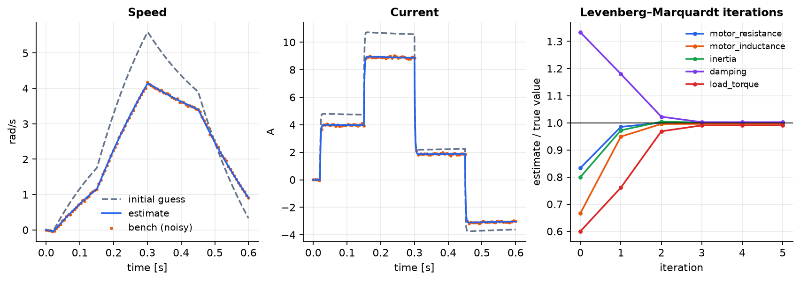

# Parameter estimation

A model is only as good as its parameters. `embeddyn mechatronics estimate` fits physical parameters (winding resistance, inductance, inertia, friction, load) to **bench measurements** by running the co-simulation with the recorded stimulus and minimising the mismatch with the recorded response. It also reports how well determined each parameter is.

## The experiment, replayed

The controller is disabled (`disable: [firmware]`) and a **replay** instance feeds the recorded duty instead, so the model is excited exactly as the hardware was (open loop). The simulated signals are interpolated to the measurement times.

## Weighted least squares

With measured samples \(y_{s,j}\) of signal \(s\) at times \(t_j\), noise levels \(\sigma_s\) and model output \(\hat y_s(t_j;\,\boldsymbol\theta)\):

\[
\min_{\boldsymbol\theta}\; \chi^2(\boldsymbol\theta) = \sum_s \sum_j r_{s,j}^2, \qquad r_{s,j} = \frac{y_{s,j} - \hat y_s(t_j;\boldsymbol\theta)}{\sigma_s}.
\]

Dividing by \(\sigma_s\) puts a current in amperes and a speed in rad/s on the same footing, each relative to its own measurement noise.

### Search space

Parameters with `scale: log` are estimated as \(z = \ln\theta\), so positive quantities stay positive and are searched by ratio; all are clipped to their bounds. A parameter that ends on a bound is flagged `at_bound`.

### Levenberg–Marquardt

Each iteration builds the Jacobian \(J = \partial r / \partial z\) by **forward differences** (one co-simulation per parameter) and solves the damped normal equations

\[
\big(J^\top J + \lambda\,\operatorname{diag}(J^\top J)\big)\,\delta = -J^\top r .
\]

A step that lowers \(\chi^2\) is accepted and \(\lambda\) divided by 3 (toward Gauss–Newton); a rejected step multiplies \(\lambda\) by 4 (toward gradient descent) and retries, up to 12 times. The fit stops when the relative cost reduction falls below `tolerance` or after `max_iterations`.

The solver is pure Python: \(J^\top J\) is only \(p \times p\) for \(p\) parameters, and the cost is dominated by the co-simulations.

## Uncertainty of the estimate

At the solution, the covariance in natural units (chain rule through the log map) is

\[
\operatorname{Cov}(\hat{\boldsymbol\theta}) \approx s^2\,(J^\top J)^{-1}, \qquad s^2 = \frac{\chi^2}{N - p}\quad\text{(reduced chi-square)}.
\]

Scaling by \(s^2\) makes the intervals right even if the stated \(\sigma_s\) are off. \(s^2 \approx 1\) means the noise levels were right *and* the model explains the data down to the noise; \(s^2 \gg 1\) means missing physics or underestimated noise.

| Output | Meaning |
|---|---|
| `estimate`, `std_error` | \(\hat\theta_i\), \(\sqrt{\operatorname{Cov}_{ii}}\) |
| `ci95` | \(\hat\theta_i \pm 1.96\,\text{std}\) |
| `correlation` | \(\rho_{ik} = \operatorname{Cov}_{ik}/\sqrt{\operatorname{Cov}_{ii}\operatorname{Cov}_{kk}}\) |
| `fit` | RMSE and \(R^2\) per fitted signal |
| `cost` | initial, final, reduced chi-square |

A correlation \(\lvert\rho\rvert\) near 1 means the experiment cannot tell those two parameters apart (e.g. inertia and damping from a test that never decelerates freely). Design a richer stimulus or fix one of them, rather than trusting either value.

## Validation on synthetic data

`examples/mechatronics/estimation/make_bench_data.py` simulates the motor with known "true" values (deliberately not the project's nominal ones) and adds Gaussian noise (0.05 A, 0.02 rad/s). Starting 17–40 % off, five iterations (37 co-simulations, 7 s) recover all five within their 95 % intervals, with reduced chi-square 0.96, as it should be when the model is exact and the noise is known.
