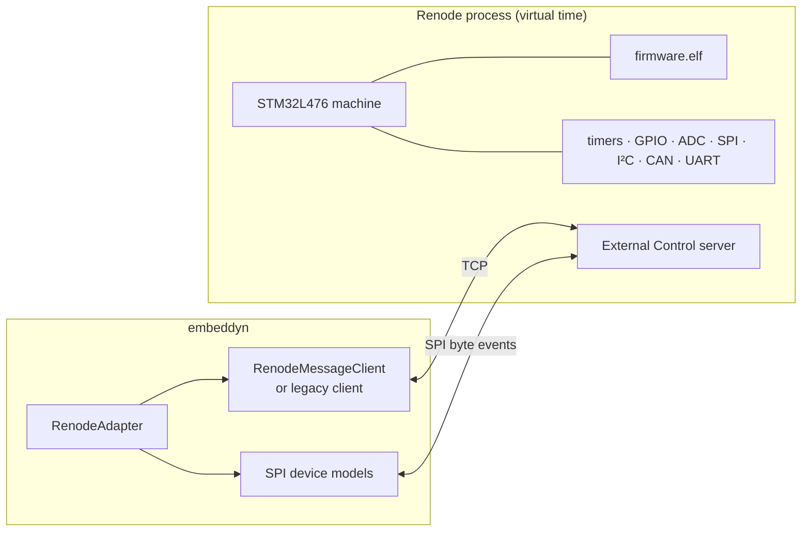
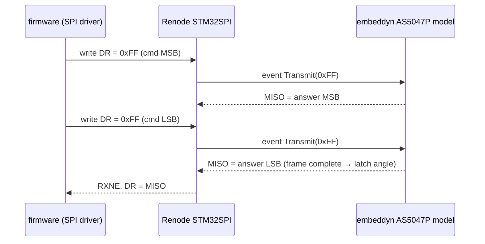

# Firmware emulation

The firmware domain runs the **unmodified ELF** on an emulated microcontroller in [Renode](https://renode.io). embeddyn controls Renode from outside through its **External Control** API, a binary protocol over TCP served by the Renode process.

## Why a separate process

* A crash or hang in the emulator cannot take the master down; the adapter stops the whole Renode process group.
* No .NET runtime inside Python, and the same adapter works against a Renode started by hand, in Docker or on another host (handy for GDB and the Monitor).
* Renode's **virtual time only advances when embeddyn sends `RunFor`**. The firmware sees exactly co-simulation time, however long a step takes on the host.

## One firmware step

For the activation ending at \(t_k\) the adapter computes an **integer-microsecond** target from the absolute co-simulation time and the origin recorded at start:

\[
\tau_k = \tau_0 + \operatorname{round}(10^6\, t_k), \qquad \Delta = \tau_k - \tau_{\text{now}} \;(\geq 0).
\]

1. **Inputs** are written: ADC channels (`IADC.SetADCValue`), input pins, memory-mapped registers and RAM variables (`sysbus` writes, optionally as IEEE-754 float32), SPI device inputs.
2. `RunFor(Δ)`: Renode executes the firmware for Δ µs of virtual time. While it runs, Renode pushes **events** to the client: GPIO edges with virtual time stamps, CAN frames, SPI bytes (which the client answers synchronously from the device model).
3. **Outputs** are read: PWM duty from edge time stamps, pulse widths, pin levels, register and RAM values, CAN-decoded fields, UART lines.

Renode's own scheduler runs the CPU in **sync quanta** (`emulation SetGlobalQuantum`). Edge time stamps are quantised to it, so the quantum sets PWM resolution: 10 µs gives 1 % duty resolution at 1 kHz.

## Turning pins into signals

**Duty from edges.** For a binding `gpio_duty` the adapter tracks the line level and accumulates high time over the step window \([\tau_{k-1}, \tau_k]\):

\[
d_k = \frac{1}{\Delta} \sum_{\text{high intervals}} \big(\min(t_\text{fall}, \tau_k) - \max(t_\text{rise}, \tau_{k-1})\big)
\]

which is the averaged duty a motor driver would see over the step. When a timer model does not toggle the pin, `register_ratio` computes \( \text{CCR}/(\text{ARR}+1) \) directly from registers instead.

**Pulse width.** `gpio_pulse_width` holds the width of the last complete high pulse, as an RC-servo or ESC decoder does, and drops to 0 after `timeout` without pulses (signal loss).

**Memory.** `sysbus` outputs read any address (byte to qword, signed, masked, float32). This is how firmware telemetry (`angle`, `duty`, `fault` in a RAM struct) becomes signals without any debug channel in the firmware.

## Sensors: three ways in

| Sensor path | Mechanism | Fidelity | Cost |
|---|---|---|---|
| **ADC** | `adc` input binding → `IADC.SetADCValue` | conversion value per channel | negligible |
| **Quadrature encoder** | write the count into the timer's `CNT` each step (`sysbus` input) | exact at every sync point, no edge-rate limit | negligible |
| **SPI device modelled in Python** | `ExternalControlSPIPeripheral`: every byte is an event answered by a `SpiDevice` | full protocol: framing, parity, error flags, registers | one round trip per byte (≈2× wall time for a 16-bit read per ms) |
| **Renode's own I²C/SPI sensor model** | a `PythonPeripheral` "feed bridge" on sysbus forwards a float32 to a property (e.g. `AS6221.Temperature`) | Renode's model of the chip | negligible |

The SPI path lets the firmware's real driver be exercised: the [AS5047P model](../reference/renode.md#sensors-on-spi-and-i2c-renode-117) answers one frame late with even parity, raises EF and ERRFL on parity or command errors, and accepts writes to its zero-position registers. Renode's STM32 SPI model does not report chip-select edges, so word-oriented devices count bytes to find frame boundaries; `finish()` resynchronises when a controller does report them.

## Bus traffic as events

CAN frames (Renode ≥ 1.17, `CANExternalControlBus`) and UART lines are published as **event signals** with their virtual time stamps, and CAN fields can be decoded into numeric signals with `struct` formats. Sending a CAN frame or a UART line from embeddyn delivers it at Renode's next sync point, and it is logged as a boundary input so runs stay reproducible.

## Protocol versions

| `api` | Renode | Client | Features |
|---|---|---|---|
| `legacy` | custom-cores fork ≤ 1.16 | `renode_api.py` | RunFor, GetTime, ADC, GPIO (+events), SystemBus |
| `message` | ≥ 1.17 | `renode_api_v2.py` | the above + CAN, SPI peripherals, framed messages |
| `auto` (default) | either | chosen from `renode --version` | |

## Process lifecycle

Renode's launcher script starts `dotnet` as a child without `exec`. The adapter therefore starts Renode in **its own session** and on stop sends SIGTERM to the whole process group, polls until it is gone, and escalates to SIGKILL. Without this, back-to-back runs (tuning!) fail with "Can't start emulation while disposing" because the previous emulator still holds the port. For parallel runs every Renode instance gets a free port and its own log file (`use_private_endpoints`).

## Limits

* Renode and the firmware cannot be checkpointed through External Control; a resumed run restarts the firmware.
* Edge-derived quantities are limited by the sync quantum; very fast PWM needs `register_ratio`.
* Only what Renode models is emulated: analog front ends, gate drivers and sensors outside the MCU belong in the electrical domain or in device models.
