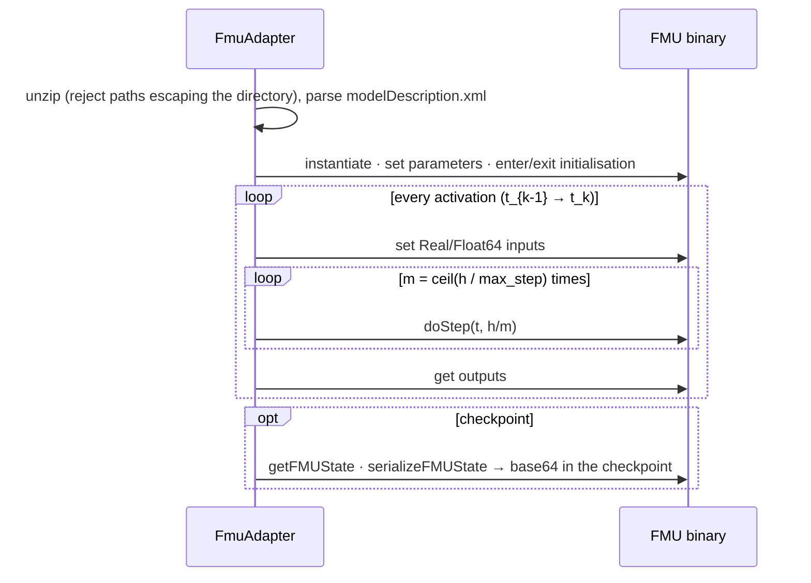

# FMI co-simulation

The [Functional Mock-up Interface](https://fmi-standard.org) is the standard way to exchange simulation models between tools. embeddyn both **imports** FMUs as simulator instances and **exports** its Python plants as FMUs.

## Import: an FMU as an instance

```yaml
instances:
  motor:
    domain: electrical
    model: fmus/DCMotor.fmu
    options:
      backend: fmu
      max_step: 1.0e-4                 # split each co-simulation step into doStep calls
      parameters: {R: "@motor.resistance"}
      inputs: {V: bridge.voltage, w: arm.speed}
      outputs: {i: motor.current, tau: motor.torque}
```

The adapter is pure Python on `ctypes`: no FMI library is needed at run time.



* FMI **2.0** and **3.0** co-simulation; the binary for the host platform is picked from `binaries/<platform>/`.
* Variable names are checked against `modelDescription.xml` when the project loads, so a typo fails before any simulator starts.
* **Checkpoints** store the serialised FMU state when the FMU declares `canGetAndSetFMUstate` and `canSerializeFMUstate`. A run resumed from one continues bit for bit. An FMU without these capabilities records only its time, and resuming it fails with a clear error rather than silently restarting at \(t = 0\).

### Accuracy

An FMU is a black box with its own solver. The master holds inputs constant over a step (zero-order hold), the same as for every other instance, so the coupling error analysis of the [master algorithm](master-algorithm.md) applies unchanged. The importer is checked against the Modelica Association Reference-FMUs (Dahlquist, VanDerPol, BouncingBall, Feedthrough) in both FMI versions with FMPy as the oracle: identical values at every step, and bit-exact state round trips.

## Export: a Python plant as an FMU

```bash
embeddyn mechatronics fmu-export embeddyn.mechatronics.plants:RCServo -o dist/ -p load_inertia=2e-4
embeddyn mechatronics fmu-check dist/RCServo.fmu
```

`fmu-export` builds an **FMI 3.0 co-simulation FMU** with PythonFMU3: plant inputs and outputs become FMU inputs and outputs, numeric constructor arguments become tunable parameters, and the ODE state becomes FMU state (get/set and serialise supported). Each `doStep` uses the same RK4 sub-stepping as `backend: python`, so swapping a plant for its exported FMU gives **bit-identical** rows, at about twice the cost.

`fmu-check` validates the model description with FMPy and runs a short co-simulation.

## When to use FMI

* You already have a model in Modelica (OpenModelica, Dymola), Simulink or Amesim.
* You want to give a plant to someone who uses another tool.
* You need a sealed, versioned model artifact in a test bench.

For models you write yourself, a Python plant is simpler to debug and just as fast in embeddyn.
