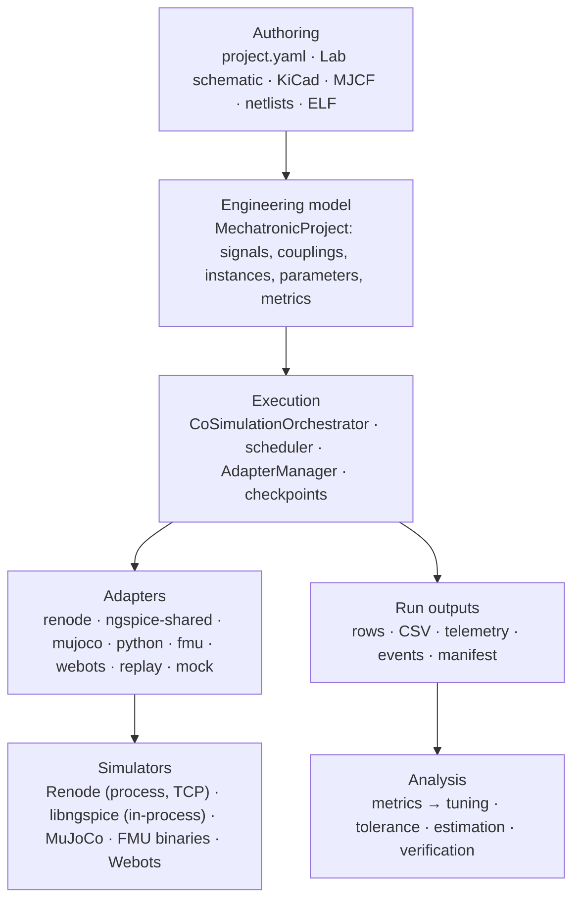
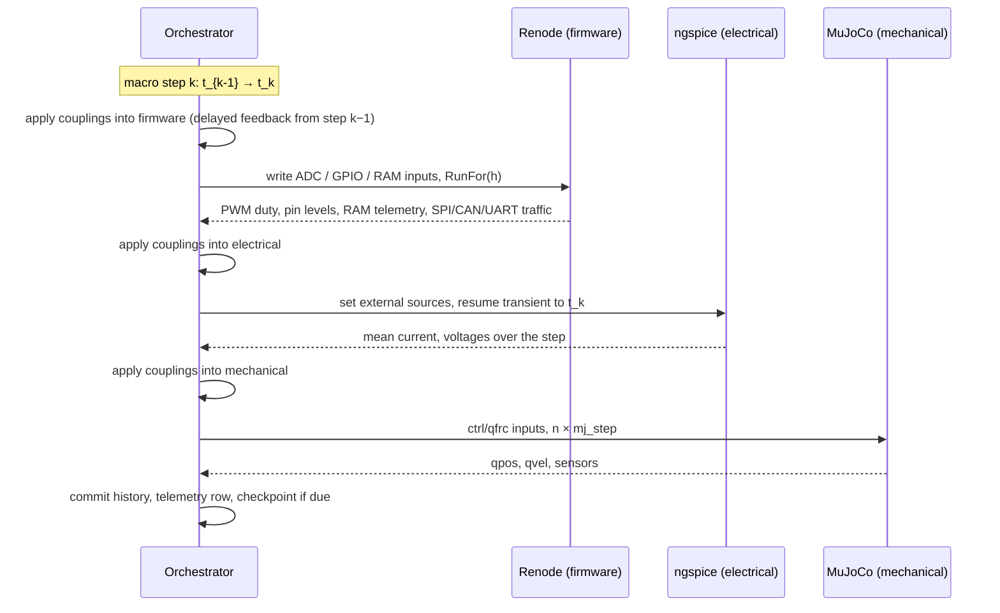

# Theory of operation

This part explains **how** embeddyn works: what happens in one co-simulation step, how each simulator is driven, and the mathematics behind the analysis tools. Read it when you need to reason about accuracy, determinism or performance, or before writing an adapter of your own.

## The layers

| Layer | Code | Page |
|---|---|---|
| Engineering model | `mechatronics/model.py` | [System model](system-model.md) |
| Execution | `orchestrator.py`, `runtime/scheduler.py`, `runtime/manager.py`, `runtime/checkpoints.py` | [Master algorithm](master-algorithm.md) |
| Firmware adapter | `adapters/renode.py`, `renode_api*.py`, `spi_devices.py` | [Firmware emulation](firmware.md) |
| Electrical adapters | `adapters/ngspice_shared.py`, `python_model.py` | [Electronics](electronics.md) |
| Mechanical adapters | `adapters/mujoco_adapter.py`, `python_model.py`, `plants.py`, `webots.py` | [Mechanics and plants](mechanics.md) |
| FMI | `adapters/fmu.py`, `fmi_export.py` | [FMI co-simulation](fmi.md) |
| Metrics | `metrics.py` | [Metrics](metrics.md) |
| Tuning | `tuning.py` | [Optimisation](optimisation.md) |
| Tolerance | `tolerance.py` | [Uncertainty and sensitivity](uncertainty.md) |
| Estimation | `estimation.py` | [Parameter estimation](estimation.md) |
| Verification | `verification.py` | [Model verification](verification.md) |
| Lab | `gui/` | [The Lab](lab.md) |

## Design principles

**Signal-oriented, not simulator-oriented.** A project talks about `motor.current` and `arm.angle`, not about SPICE vectors or Renode registers. Adapters translate at the edge, so you can replace the averaged H-bridge model with a switching ngspice netlist, or a Python rotor with a MuJoCo arm, without touching the rest of the project.

**Deterministic by construction.** Time is an integer step index; instances run in a fixed order; Renode's virtual time only moves when the master sends `RunFor`; random sampling is seeded. The same project and parameters give the same rows, bit for bit, which is what makes golden-waveform tests, checkpoint/resume and optimisation over full runs work.

**Real firmware, unmodified.** The firmware domain runs the ELF you would flash. It reads sensors through its own SPI, I²C, ADC and timer drivers, and the adapter only touches what hardware would touch: pins, peripheral registers and RAM where you choose to inject calibration values.

**Every run is an experiment.** Tuning, tolerance analysis, estimation and verification are all *outer loops* over the same `run`. Anything you can run, you can score, optimise and test.

## One step at a glance

The rest of this section takes each arrow apart.
