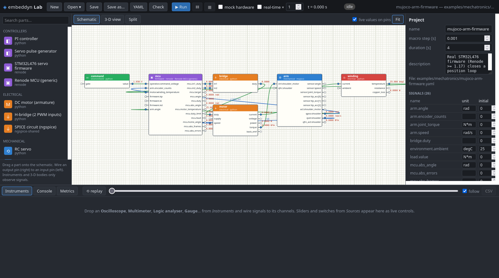
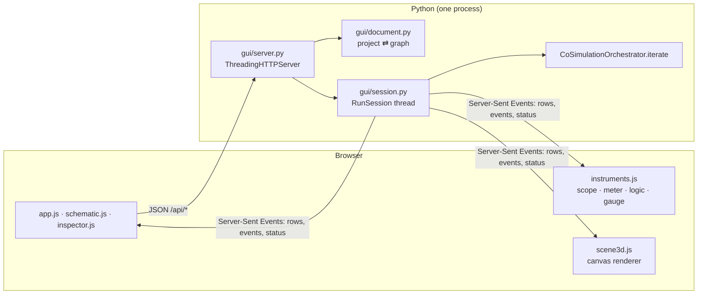
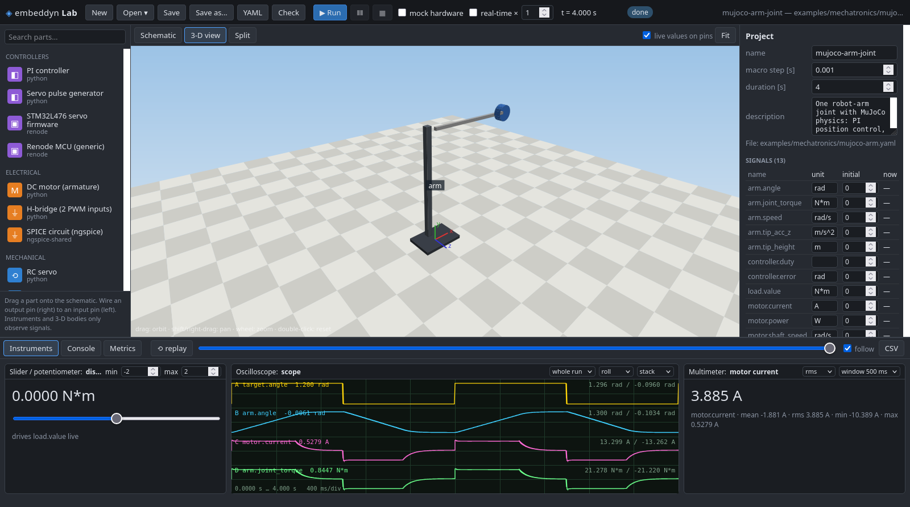

# The Lab

The Lab (`embeddyn mechatronics gui`) is a browser front end on the same engine. A schematic in the Lab and the project file are two views of one document, and a run in the Lab is the same `CoSimulationOrchestrator` the CLI uses, so results match exactly.

## Architecture

* **No build step, no CDN.** Plain HTML and JavaScript served by Python's standard library; nothing beyond embeddyn's own dependencies.
* **Document mapping.** `document.py` turns a project into a graph: nodes for instances, pins from plant inputs/outputs, Renode bindings, ngspice bindings, MuJoCo addresses, SPI device fields and replay columns; edges for nets (a plant input reading a signal), couplings and probes. Saving writes an ordinary project file; Lab-only layout lives under `metadata.gui`, which the CLI ignores. Sections the Lab does not edit (`metrics`, `verification`, `scheduler`, …) are kept verbatim.
* **Runs.** A `RunSession` runs `iterate()` in a thread and buffers rows; the browser subscribes to `/api/stream` (SSE) and draws at display rate. Pause, resume, stop (closing the generator stops every adapter), real-time pacing and **forced signals** (sliders and switches hold a signal at the operator's value every step) are session controls.
* **Replay.** The recorded rows of the last run can be scrubbed with a time cursor; instruments and the 3-D view follow it.

## Wires

| Wire | Colour | Becomes in the file |
|---|---|---|
| net | green | `options.inputs` of a Python/FMU/MuJoCo instance |
| coupling | blue | a `couplings:` entry (gain, offset, clamp, deadband, quantise, delay) |
| probe | orange, dashed | nothing in the simulation; an instrument or 3-D body observes a signal |

## 3-D view

A small flat-shaded canvas renderer draws bodies (servo, arm, wheel…) whose pose follows signals. It is a visualisation of the co-simulation state, not a physics engine: the physics is wherever the project puts it (MuJoCo, a plant, an FMU).

## Security

The API opens and writes project files and launches simulators, so the server binds to `127.0.0.1` by default, refuses cross-origin POSTs and only writes `.yaml` files. Do not expose it on a network.
