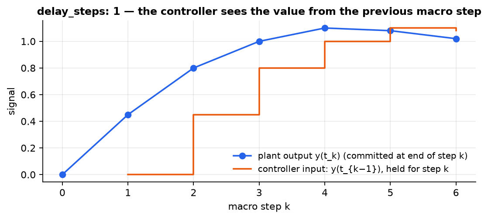
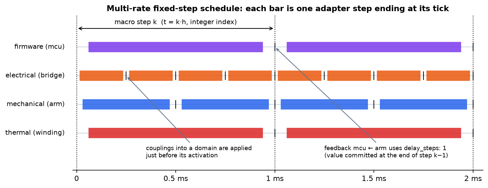

# Master algorithm

The `CoSimulationOrchestrator` advances all instances together in **macro steps**. It is an explicit, fixed-step, sequential (Gauss–Seidel) co-simulation master with optional multi-rate sub-stepping, fixed-point iteration on couplings, real-time pacing and checkpoints.

## The time base

The macro step is \(h\) = `step_seconds`. Step \(k\) covers \((t_{k-1}, t_k]\) with

\[
t_k = \min(k\,h,\; T), \qquad k = 1, \dots, \left\lceil T/h \right\rceil .
\]

\(k\) is an integer. Time is never accumulated as `t += h`, so after a million steps \(t_k\) is still exact, and a run resumed from a checkpoint lands on exactly the same instants as an uninterrupted one. Renode's virtual clock is driven in integer microseconds derived from the same \(t_k\).

## One macro step

```text
for activation in scheduler.activations(t_{k-1}, t_k):        # ordered list, see below
    apply couplings whose target is in activation.domain      # Gauss–Seidel: fresh values
    outputs = adapter.step(activation.time, activation.step, inputs = parameters ∪ signals)
    write outputs (clamped); publish events
commit history (values at t_k become "1 step ago")
write telemetry row; save checkpoint if due
```

### Ordering

Activations within a macro step are sorted by **target time**, then by domain rank

\[
\text{firmware} \prec \text{electrical} \prec \text{mechanical} \prec \text{thermal} \prec \text{environment},
\]

then by declaration order. The order is part of the model: the electrical instance in step \(k\) sees the duty the firmware computed *in the same step*, while the firmware sees the mechanical position only through a delayed coupling.

### Why feedback needs `delay_steps: 1`

Consider firmware → electrical → mechanical → (back to) firmware. Without a delay, the encoder coupling into firmware would read the angle *before* the mechanical instance has run in step \(k\). That is the value from step \(k-1\), but only by accident of ordering, and it changes if instances are reordered. `delay_steps: 1` makes the intent explicit and order-independent: the target reads \(s_{k-1}\) from the committed history.



The price is one macro step of transport delay in the loop. For a controller sampled at \(h\) this is what the real system does anyway (the firmware reads the encoder, then computes, then updates PWM). For a stiff physical loop (electrical ↔ mechanical through back-EMF) it introduces an \(O(h)\) error. [Step-size convergence](verification.md#step-size-convergence) measures it: an observed order near 1 is the signature of this scheme.

## Multi-rate schedules

An instance (or a domain, through `scheduler.domains`) may take a step \(h_i = h / m_i\), \(m_i \in \mathbb{N}\). The `multirate-fixed-step` scheduler expands each macro step into all activations \(t_{k-1} + j\,h_i\), \(j = 1..m_i\), sorted by time then rank:



Each activation receives its own end time and step, so a 4 kHz ngspice bridge and a 1 kHz firmware loop advance in a consistent interleaving. Couplings into a domain are re-applied before *each* of its activations.

## Fixed-point iteration (optional)

With `scheduler.convergence.enabled: true` the couplings into a domain are applied repeatedly until

\[
\max_i \left| s^{(i),\,(\nu+1)} - s^{(i),\,(\nu)} \right| \le \varepsilon
\]

or `max_iterations` is reached (`failure_policy`: `error`, `warn` or `accept`). This only iterates the *coupling transforms*, not the simulators, so it resolves chains of zero-delay couplings (e.g. a clamp after a gain after a quantiser), not a physical algebraic loop. A true algebraic loop needs a delay, or the two halves in one model (one FMU, one netlist, one plant).

## Real-time pacing

`real-time-fixed-step` and `real-time-multirate` (or `real_time.enabled`) wrap the scheduler: before each macro step the master sleeps until wall time reaches \(t_\text{wall,0} + (t_k - t_0)/\text{speed}\). Lateness beyond `deadline_tolerance` counts as a deadline miss (`continue`, `warn` or `abort`). The Lab uses this for its "real-time ×" option. Determinism is unaffected: pacing only delays, it never changes step sizes.

## Adapters: the contract

Every simulator is wrapped by a `SimulatorAdapter`:

```python
class SimulatorAdapter:
    def start(self, initial_signals) -> None: ...                       # launch / load / initialise
    def step(self, time_seconds, step_seconds, inputs) -> StepResult: ... # advance to time_seconds
    def stop(self) -> None: ...
    def checkpoint(self) -> object: ...          # optional: opaque, JSON-serialisable state
    def restore(self, state) -> None: ...
    def capabilities(self) -> dict[str, bool]: ...
```

`step` receives the **target time** of the activation, not just a duration, so adapters with their own clocks (Renode, ngspice, FMUs) align to absolute time and refuse to run backwards. `StepResult.outputs` maps signal names to values; `diagnostics` may carry `events` (time-stamped topics) and anything useful for debugging (`run_for_us`, `substeps`).

The `AdapterManager` starts the adapters one after another and, if one fails to start, stops those already running. Leaving `iterate()` (normally, by exception or by closing the generator) always stops every adapter, which is what lets the Lab's Stop button and a failing tuning evaluation clean up Renode processes.

## Checkpoints and resume

A checkpoint is a JSON document:

```json
{"version": 1, "time_seconds": 0.5, "values": {...}, "history": {...},
 "events": {...}, "adapters": {"arm": {...}, "bridge": {...}}, "activation_count": {...}}
```

`--checkpoint-interval` writes one every so many simulated seconds; `--resume-from` restores it and continues. Python plants store their state vector, MuJoCo its full `mjData` integration state, FMUs their serialised FMU state when they support it. Renode and ngspice cannot be snapshotted through their control interfaces, so projects with them can checkpoint the rest of the system but not resume bit-for-bit.

## Determinism checklist

| Source of non-determinism | How it is removed |
|---|---|
| floating-point time accumulation | integer step index |
| instance order | fixed rank + declaration order |
| emulator wall-clock | Renode virtual time advanced only by `RunFor` |
| ngspice adaptive steps | the transient is stopped exactly at \(t_k\) (`GetSyncData`) |
| random sampling | seeded generators (tolerance, CMA-ES) |
| parallel workers | results keyed by input, not completion order |

The [verification](verification.md#golden-waveforms) golden-waveform check relies on this: the DC-motor example reproduces its golden CSV to \(3.6\times10^{-15}\).
