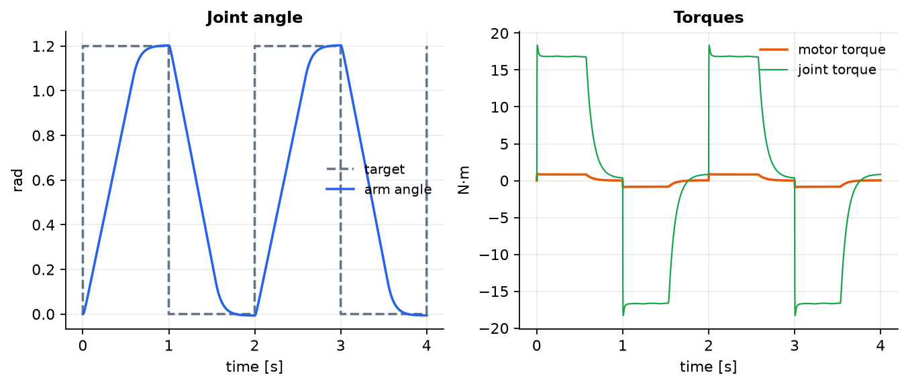

# Mechanics and plants

Mechanical, thermal and environmental physics come from three kinds of model: **Python plants** (small ODEs, fast, exact checkpoints), **MuJoCo** (multibody dynamics with joints, gravity and contacts) and **FMUs** (anything exported from Modelica, Simulink, Amesim…; see [FMI](fmi.md)). Webots is supported through a socket bridge for visual worlds.

## Python plants

A plant is a plain class with named inputs, outputs and states:

```python
class MyPlant:
    inputs = ("torque",)
    outputs = ("speed", "angle")
    states = ("angle", "speed")
    def __init__(self, inertia=0.01, damping=0.001): ...
    def initial_state(self): return [0.0, 0.0]
    def derivatives(self, t, x, u): return [x[1], (u["torque"] - self.damping * x[1]) / self.inertia]
    def output(self, t, x, u): return {"angle": x[0], "speed": x[1]}
```

The adapter holds the inputs \(u\) for the step and integrates with classical fourth-order **Runge–Kutta** in \(n = \lceil h/\Delta_{\max} \rceil\) equal sub-steps of size \(\delta = h/n\):

\[
\begin{aligned}
k_1 &= f(t, x, u), & k_2 &= f(t+\tfrac{\delta}{2}, x + \tfrac{\delta}{2}k_1, u),\\
k_3 &= f(t+\tfrac{\delta}{2}, x + \tfrac{\delta}{2}k_2, u), & k_4 &= f(t+\delta, x + \delta k_3, u),\\
x &\leftarrow x + \tfrac{\delta}{6}(k_1 + 2k_2 + 2k_3 + k_4).
\end{aligned}
\]

`max_step` (\(\Delta_{\max}\), default \(10^{-4}\) s) must resolve the stiffest mode of the plant: a shaft with stiffness 2000 N·m/rad on 0.002 kg·m² rotor inertia oscillates at ~160 Hz, comfortably inside \(10^{-5}\) s steps. A diverging state raises an error naming the plant and the time instead of filling the run with NaN.

Parameters given as `"@name"` are looked up in the project's parameters at start, so tuning and tolerance analysis can change them per run. A checkpoint is just `{time, state}`, so Python plants resume bit for bit.

### Built-in plants (`embeddyn.mechatronics.plants`)

| Plant | States | Physics |
|---|---|---|
| `DCMotorRL` | \(i\) | armature \(L\dot i = dV - Ri - K_e\omega\), torque \(K_t i\) |
| `HBridgePWM` | — | sign-magnitude bridge: \(d = \text{in}_1 - \text{in}_2\) |
| `GearedDrivetrain` | \(\theta_m, \omega_m, \theta_l, \omega_l\) | rotor → gear with **backlash** → compliant shaft → load with viscous, Coulomb and **Stribeck** friction; encoder counts; dissipated and stored energy |
| `RCServo` | angle, speed, current | pulse decoder, proportional amplifier, motor, gearbox, horn, feedback pot |
| `ThermalRC` | \(T\) | \(C\dot T = I^2R(T) - (T - T_a)/R_{th}\), \(R(T) = R_{20}(1 + \alpha(T-20))\) |
| `PIController` | integral | PI with clamping and anti-windup |

**Backlash.** The gear transmits torque only outside the dead zone \(\pm b/2\):

\[
\Delta = \frac{\theta_m}{N} - \theta_l, \qquad
\tau_\text{shaft} = \begin{cases} k\,(\Delta - \tfrac b2) + c\,\dot\Delta & \Delta > \tfrac b2\\ 0 & |\Delta| \le \tfrac b2 \\ k\,(\Delta + \tfrac b2) + c\,\dot\Delta & \Delta < -\tfrac b2 \end{cases}
\]

with \(\dot\Delta = \omega_m/N - \omega_l\). The damper may not pull the teeth apart: a torque whose sign opposes the twist is set to zero, so an opening contact transmits nothing. A gear efficiency \(\eta\) scales the reflected torque when the motor drives the load.

**Friction** is regularised with \(\tanh\) so the ODE stays smooth (no event detection needed):

\[
\tau_f = b_v\,\omega + \Big(\tau_C + (\tau_S - \tau_C)\,e^{-(\omega/\omega_S)^2}\Big)\tanh(\omega/\omega_\epsilon).
\]

**Thermal feedback.** `ThermalRC` outputs the winding resistance, which can be coupled back into the electrical model, closing the current → heating → resistance → current loop. In the arm-joint tutorial the same temperature is also fed to the firmware's I²C temperature sensor.

## MuJoCo multibody

`backend: mujoco` loads an MJCF model in-process. Each co-simulation step:

1. writes inputs into `ctrl` (actuators) and `qfrc_applied` (generalised joint forces);
2. calls `mj_step` \(n = h / \Delta t_\text{MuJoCo}\) times (the macro step must be a whole multiple of the model's timestep; the adapter refuses otherwise);
3. reads `qpos`, `qvel`, `qfrc_actuator`, sensors, body positions.



MuJoCo's full integration state (`mj_getState`: positions, velocities, activations, warm-start) is saved in checkpoints, so runs resume bit for bit. An `initial:` option sets joint positions and velocities before the first `mj_forward`, so a test can start the arm away from its rest pose.

### Who owns the motor?

When another instance models the winding (`DCMotorRL`, ngspice, an FMU), MuJoCo should see a plain `<motor>` actuator driven with the shaft torque, with the rotor inertia reflected into the joint's `armature` (\(J_\text{rotor} N^2\)) and the joint speed coupled back to the back-EMF through the gear ratio. Using MuJoCo's `dcmotor` actuator at the same time would count the electrical dynamics twice.

## Webots

The Webots adapter starts Webots in fast batch mode and exchanges line-delimited JSON with a Supervisor controller over a local socket. It is useful for visual worlds and existing PROTO models, but Webots integrates its own ODE at its own `basicTimeStep` and offers no state snapshot, so it cannot checkpoint or reproduce runs bit-for-bit. Prefer MuJoCo for anything you want to tune or regression-test.

## Choosing a model

| Need | Use |
|---|---|
| a drivetrain, a thermal mass, a sensor front end | Python plant |
| a linkage, gravity, joint limits, contact | MuJoCo |
| a model from another tool (Modelica, Simulink) | FMU |
| a 3-D world with cameras and robots for demos | Webots |
| recorded data as a stimulus | `replay` |
