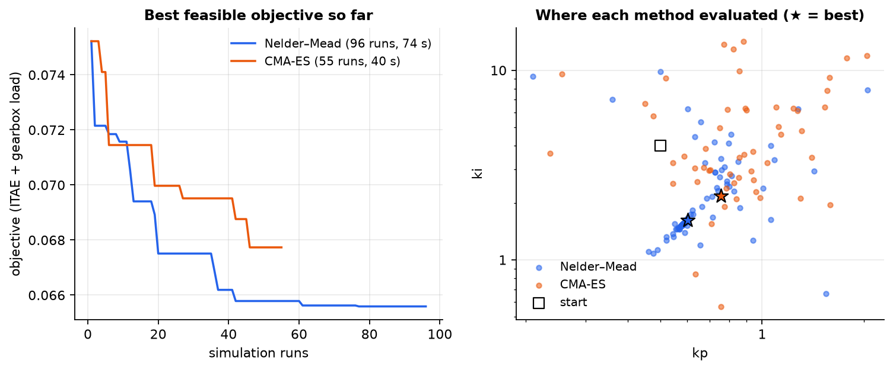

# Optimisation

`embeddyn mechatronics tune` searches for parameter values (controller gains, a gear ratio, a filter cut-off) that minimise an objective built from [metrics](metrics.md), subject to constraints. Every evaluation is **one full co-simulation**, real firmware included. That rules out gradient methods (no derivatives, and quantised firmware makes the objective piecewise constant on small scales) and favours robust derivative-free methods that make good use of few, expensive, parallelisable evaluations.

## The problem

\[
\min_{\mathbf{p} \in [\mathbf{p}_\text{min}, \mathbf{p}_\text{max}]} \; J(\mathbf{p}) = \sum_j w_j\, m_j(\mathbf{p}) \;+\; \sum_c P_c(\mathbf{p})
\]

where \(m_j\) are metric figures from one run with parameters \(\mathbf{p}\) and \(P_c\) are constraint penalties:

\[
P_c = \begin{cases} 0 & \text{if } m_c \text{ within limits}\\[2pt]
10^3 \left(1 + \dfrac{\text{excess}}{\max(\lvert\text{bound}\rvert, 10^{-9})}\right) & \text{if violated}\\[2pt]
10^6 & \text{if } m_c \text{ is missing (e.g. never settles)} \end{cases}
\]

The penalty is large enough that any feasible point beats any infeasible one in practice, and graded so that the search is still pulled toward feasibility from an infeasible start.

### The unit box

Each parameter is mapped to \(u \in [0, 1]\), linearly or, with `scale: log`, logarithmically:

\[
u = \frac{\ln p - \ln p_\text{min}}{\ln p_\text{max} - \ln p_\text{min}} .
\]

Log scaling is right for gains, time constants and resistances, whose effect depends on ratios: a step from 1 to 2 matters as much as one from 10 to 20. Both optimisers work in the unit box, so one step size suits every parameter.

## Nelder–Mead

The default method is the downhill simplex: \(n+1\) points in \(n\) dimensions that reflect, expand, contract and shrink toward a minimum. It is robust on the noisy-looking, plateau-rich objectives that firmware produces, and it needs no tuning of its own (initial step 0.15 in the unit box, stopping when the simplex is smaller than `tolerance`).

```text
sort simplex; x̄ = centroid of all but the worst xw
xr = x̄ + (x̄ − xw)                         reflect
  if J(xr) < J(best):   xe = x̄ + 2(x̄ − xw);  keep the better of xe, xr     expand
  elif J(xr) < J(2nd worst): keep xr
  else: xc = x̄ + ½(xw − x̄);  keep if better than xw, else shrink toward best
```

### Speculative parallel Nelder–Mead

Nelder–Mead is inherently sequential: which point comes next depends on the last result. embeddyn parallelises it **without changing its path**:

* every iteration submits the reflection, expansion and contraction **together**, and a shrink's \(n\) points together;
* the decisions are then taken exactly as the sequential algorithm would, from the cached results;
* points the sequential search would not have needed are marked `counted: false` (**speculative**). They cost idle worker time, not budget.

So with 1 or 8 workers the simplex path, the counted evaluations and the result are identical; only the wall time changes. On the arm firmware with 4 workers: 30 counted evaluations, 52 runs, 6.8 min instead of ~11.8 min sequentially (×1.7). Utilisation is limited to about 3 of 4 workers because an iteration rarely needs all three candidates.

## CMA-ES

`method: cmaes` is the covariance matrix adaptation evolution strategy, \((\mu/\mu_w, \lambda)\) with rank-one and rank-\(\mu\) updates and cumulative step-size adaptation (Hansen). Each **generation** samples \(\lambda\) candidates from a multivariate normal around the mean:

\[
\mathbf{x}_i = \mathbf{m} + \sigma\, \mathbf{B}\mathbf{D}\,\mathbf{z}_i, \qquad \mathbf{z}_i \sim \mathcal{N}(0, \mathbf{I}), \quad \mathbf{C} = \mathbf{B}\mathbf{D}^2\mathbf{B}^\top ,
\]

ranks them, and moves the mean to the weighted average of the best \(\mu = \lfloor\lambda/2\rfloor\):

\[
\mathbf{m} \leftarrow \mathbf{m} + \sigma \sum_{i=1}^{\mu} w_i\, \mathbf{y}_{i:\lambda}, \qquad w_i \propto \ln(\mu + \tfrac12) - \ln i .
\]

The covariance learns the shape of the valley from the successful steps (rank-\(\mu\)) and from the evolution path \(\mathbf{p}_c\) (rank-one); \(\sigma\) grows when consecutive steps point the same way and shrinks when they cancel (path \(\mathbf{p}_\sigma\) vs. its expected length \(\chi_n\)):

\[
\mathbf{C} \leftarrow (1 - c_1 - c_\mu)\,\mathbf{C} + c_1\, \mathbf{p}_c\mathbf{p}_c^\top + c_\mu \sum_i w_i\, \mathbf{y}_{i:\lambda}\mathbf{y}_{i:\lambda}^\top, \qquad
\sigma \leftarrow \sigma \exp\!\Big(\frac{c_\sigma}{d_\sigma}\Big(\frac{\lVert\mathbf{p}_\sigma\rVert}{\chi_n} - 1\Big)\Big).
\]

Implementation choices:

* **Bounds by mirroring.** Candidates outside \([0,1]\) are reflected back (period-2 mirror), and the step actually taken is used in the updates, so the distribution stays consistent near bounds.
* **Seeded.** `np.random.default_rng(seed)`: a run is reproducible.
* **One generation = one batch.** All \(\lambda\) candidates are evaluated in parallel, so workers stay busy (3.85 of 4 on the arm firmware) and the result does not depend on the number of workers.
* Defaults: \(\lambda = 4 + \lfloor 3\ln n\rfloor\) (override with `population`), \(\sigma_0\) = `sigma` = 0.25 in the unit box, stop when \(\sigma \cdot \max D <\) `tolerance` or the budget has no room for another whole generation. The start point is evaluated first so the report always has the same baseline.

## Which one?



*Geared servo with backlash, 2 PI gains, 4 workers, budget 60. Nelder–Mead walks a tight path to the valley floor; CMA-ES samples the whole region and stops at the budget.*

| | Nelder–Mead | CMA-ES |
|---|---|---|
| Best for | 1–4 parameters, smooth-ish objectives, small budgets | 4+ parameters, noisy or multi-modal objectives, many workers |
| Parallel efficiency | limited (speculative candidates) | full (whole generations) |
| Results on the arm firmware (3 gains, 4 workers) | best 13.7639; within 0.1 % after 36 runs | best 13.7675; within 0.1 % after 12 runs |
| Reproducible | yes (deterministic) | yes (seeded) |

On a flat, smooth two- or three-parameter problem Nelder–Mead typically finishes slightly lower; CMA-ES gets close faster and scales better. Both report every evaluation in `history`, so you can inspect the trade-offs (overshoot vs energy, say) around the optimum rather than taking a single point on trust.

## Robustness of the loop

* A failed evaluation (simulator crash, diverging plant) scores \(+\infty\) and is recorded with its error; the search continues.
* Parallel workers are spawned processes (no inherited sockets or simulator state), and each Renode instance gets a private port and log.
* Results are cached per point, so repeated points are free.
