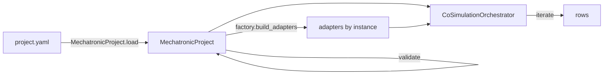

# System model

A project file is parsed into a `MechatronicProject` (`mechatronics/model.py`). It is a plain data structure; nothing runs until an orchestrator is built from it and its adapters.

## Signals: the shared state

The global state of a co-simulation at time \(t_k\) is the vector of signal values

\[
\mathbf{s}_k = \big(s^{(1)}_k, \dots, s^{(n)}_k\big), \qquad s^{(i)}_0 = \text{initial}_i .
\]

Each signal has a **domain** (firmware, electrical, mechanical, thermal, environment), a **unit**, optional **limits** and a **kind**:

| Kind | Stored in the row | History kept | Typical use |
|---|---|---|---|
| `continuous` | value | yes (for delays) | voltages, currents, angles |
| `discrete` | value | yes | modes, fault flags, counters |
| `event` | no (published to the event queue) | no | CAN frames, UART lines, alarms |
| `bus` | latest payload | no | structured messages |

Writes are **clamped** to `[min, max]`, both when an adapter returns a value and when a coupling writes it. A duty signal declared with `min: -1, max: 1` can therefore never leave that range whatever the controller outputs.

The signal's domain decides *when* couplings into it are applied (just before an instance of that domain runs), not who may write it: any adapter may output any signal.

## Couplings: the wiring

A coupling is a directed edge \(s^{(j)} \to s^{(i)}\) with a transform \(f\) and a delay \(d \in \mathbb{N}\):

\[
s^{(i)} \leftarrow \operatorname{clamp}_i\Big(f\big(s^{(j)}_{k-d}\big)\Big)
\]

| Transform | \(f(x)\) |
|---|---|
| `affine` (default) | \(g\,x + o\) |
| `identity` | \(x\) |
| `deadband` | \(0\) if \(\lvert x\rvert < \delta\) else \(x\) |
| `quantize` | \(q\,\operatorname{round}(x/q) + o\) |
| `clamp` | \(x\) limited to `min`/`max` |

Every transform also takes its own `min`/`max`. Arbitrary expressions are deliberately not supported: a project file must not be able to execute code. Anything more complex than a transform belongs in a plant model.

With \(d = 0\) the target sees the source's value **as it is at that moment of the step**, which depends on execution order (see [master algorithm](master-algorithm.md)). With \(d \geq 1\) it sees the value committed at the end of step \(k-d\). The orchestrator keeps a ring buffer of \(\max d + 2\) values per continuous or discrete signal.

## Instances

An instance is `(name, domain, backend, model, options, step)`. Names match `^[A-Za-z][A-Za-z0-9_-]{0,63}$` and are unique. Two spellings exist:

=== "Named instances"

    ```yaml
    instances:
      left:  {domain: electrical, model: "embeddyn.mechatronics.plants:DCMotorRL", options: {backend: python, ...}}
      right: {domain: electrical, model: "embeddyn.mechatronics.plants:DCMotorRL", options: {backend: python, ...}}
    ```

=== "Legacy, one per domain"

    ```yaml
    simulators:
      electrical: {model: motor.cir, options: {backend: ngspice-shared, bindings: bindings/ngspice.yaml}}
    ```

A domain with no instance still gets a slot in the schedule, so couplings into its signals are applied every step. This is how a pure-coupling signal (e.g. `mechanical.motor_torque = Kt · current`) works without any mechanical simulator.

## Parameters and their provenance

Parameters are `name → Quantity(value, unit)` with a provenance list (`project`, `component-instance`, `runtime-override`, `tuning`, …). They come from three places, later ones overriding earlier ones:

1. the `parameters:` section;
2. `components.instances.<name>.parameters` (as `<name>.<param>`);
3. `--parameter-overrides` / the analysis tools (`apply_parameter_overrides`), which append a provenance entry.

Adapters receive parameters alongside signal values. Python plants reference them as `"@name"`, Renode bindings write them into RAM, FMUs set them before initialisation. The run manifest records the resolved set with provenance.

!!! note "Units are recorded, not converted"
    `Quantity.parse("2 kohm")` gives `value=2.0, unit="kohm"`. The number is used as written, so write SI base values.

## Scheduler configuration

```yaml
step_seconds: 0.001                 # macro step h
duration_seconds: 4.0
scheduler:
  algorithm: multirate-fixed-step   # deterministic-fixed-step | multirate-fixed-step | real-time-*
  domains: {electrical: 0.00025}    # per-domain step (must divide h)
  convergence: {enabled: false, tolerance: 1.0e-9, max_iterations: 8, failure_policy: error}
  real_time: {enabled: false, speed_factor: 1.0, deadline_tolerance: 0.01, missed_deadline_policy: continue}
```

Giving any instance its own `step` switches the default algorithm to `multirate-fixed-step`. Validation rejects steps that do not divide the macro step to within \(10^{-9}\).

## From model to run



`factory.build_adapters(project, mock=False)` maps each instance's `backend` to an adapter class and its options to constructor arguments: `renode`, `ngspice`, `ngspice-shared`, `ltspice`, `python`, `mujoco`, `fmu`, `webots`, `replay`, `mock`. `--mock` replaces firmware, electrical and mechanical backends with the built-in mocks.
