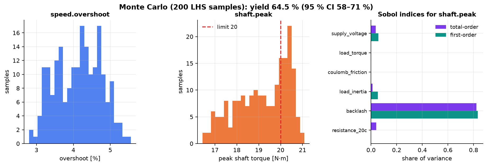

# Uncertainty and sensitivity

Real parts are not nominal. `embeddyn mechatronics tolerance` answers two questions about a design under component spreads:

1. **Yield**: what fraction of built units will meet the specification? (Monte Carlo)
2. **Sensitivity**: which tolerances cause the spread, and which don't matter? (Sobol indices)

Both are outer loops of full co-simulations, run in parallel worker processes.

## Distributions

Each uncertain parameter has a distribution, sampled through its inverse CDF \(F^{-1}(u)\) from a uniform \(u \in (0,1)\), so every sampling design shares one code path:

| `distribution` | Parameters | \(F^{-1}(u)\) |
|---|---|---|
| `normal` | `mean`, `sigma` (or `nominal` ± `tolerance` = 3σ) | \(\mu + \sigma\,\Phi^{-1}(u)\) |
| `uniform` | `minimum`, `maximum` (or `nominal` ± `tolerance`) | \(a + (b-a)\,u\) |
| `lognormal` | `median`, `sigma_log` | \(m\,e^{\sigma\Phi^{-1}(u)}\) |
| `triangular` | `minimum`, `mode`, `maximum` | piecewise square-root inverse |
| `choice` | `values` | the \(\lfloor u\,n\rfloor\)-th value (e.g. E-series parts) |

`tolerance` is relative: a 2.0 Ω winding with `tolerance: 0.05` and `distribution: normal` has \(\sigma = 0.1/3\) Ω (±5 % is the 3σ range, the usual datasheet convention).

## Monte Carlo yield

\(N\) parameter sets are drawn by **Latin hypercube sampling** (default) or plain random sampling. LHS splits each dimension into \(N\) equal-probability strata and places exactly one sample in each, with the strata shuffled independently per dimension:

\[
u_{ij} = \frac{\pi_j(i) + v_{ij}}{N}, \qquad v_{ij} \sim U(0,1), \; \pi_j \text{ a random permutation.}
\]

Every marginal is then covered evenly, which reduces the variance of means and percentiles compared with random sampling at the same \(N\).

For each sample the project runs and the chosen metric figures are recorded. The report gives per output the mean, standard deviation, min/max and 5/50/95 % percentiles; and the **yield**, the fraction of samples meeting every limit, with a **Wilson score interval**:

\[
\hat p = \frac{s}{N}, \qquad \frac{\hat p + \frac{z^2}{2N} \pm z\sqrt{\frac{\hat p(1-\hat p)}{N} + \frac{z^2}{4N^2}}}{1 + \frac{z^2}{N}}, \quad z = 1.96 .
\]

The Wilson interval stays inside \([0,1]\) and is reliable for yields near 0 or 1, where the textbook \(\hat p \pm z\sqrt{\hat p(1-\hat p)/N}\) fails.

## Sobol sensitivity

Variance-based sensitivity splits the output variance \(V(Y)\) into contributions of each input \(X_i\):

\[
S_i = \frac{V\big(E[Y \mid X_i]\big)}{V(Y)}, \qquad
S_{T_i} = \frac{E\big(V[Y \mid X_{\sim i}]\big)}{V(Y)} .
\]

\(S_i\) (first-order) is the share caused by \(X_i\) alone; \(S_{T_i}\) (total) adds every interaction involving \(X_i\). \(S_{T_i} \approx 0\) means the tolerance can be loosened for that output.

They are estimated from two independent sample matrices \(A, B\) (\(N \times k\)) and \(k\) mixed matrices \(A_B^{(i)}\) (\(A\) with column \(i\) taken from \(B\)), \(N(k+2)\) runs in all:

\[
\hat S_i = \frac{\frac1N \sum_j f(B)_j \big(f(A_B^{(i)})_j - f(A)_j\big)}{\hat V}
\quad\text{(Saltelli 2010)}, \qquad
\hat S_{T_i} = \frac{\frac{1}{2N}\sum_j \big(f(A)_j - f(A_B^{(i)})_j\big)^2}{\hat V}
\quad\text{(Jansen 1999)}.
\]

Outputs are **centred** on the pooled mean before estimation. The estimators are shift-invariant only in expectation; without centring, an output with a large mean and a small spread (a winding at 28 ± 0.2 °C) has first-order confidence intervals of about ±40 instead of ±0.25. 95 % intervals come from bootstrap resampling of the \(N\) rows.

The estimators are tested against closed-form answers: a linear model and the Ishigami function (\(S_1 = 0.314\), \(S_2 = 0.442\), \(S_3 = 0\), \(S_{T_3} = 0.244\)), within ±0.05.

## Reading the result

*Geared servo, six tolerances, 200 LHS samples and 512 Sobol runs. Overshoot stays well under its limit; peak shaft torque crosses its 20 N·m limit in about a third of the units, and the Sobol indices put almost all of that spread on the **gearbox backlash**. Tightening the winding or supply tolerance would not help.*

* \(\sum_i S_i \approx 1\): the output is additive in the inputs. Well below 1: interactions matter, look at \(S_{T_i} - S_i\).
* Small negative \(\hat S_i\) are estimation noise around 0.
* An output missing in some runs (never settles) is skipped for sensitivity with a note; for yield it counts as a failure.

## Cost

Monte Carlo cost is \(N\) runs; Sobol \(N(k+2)\). With 6 parameters and \(N = 64\) that is 512 runs. Runs are independent, so the cost divides by the number of workers; with Renode in the loop each worker gets its own emulator, port and log.
