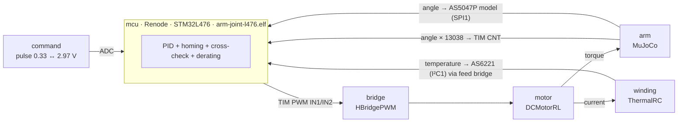
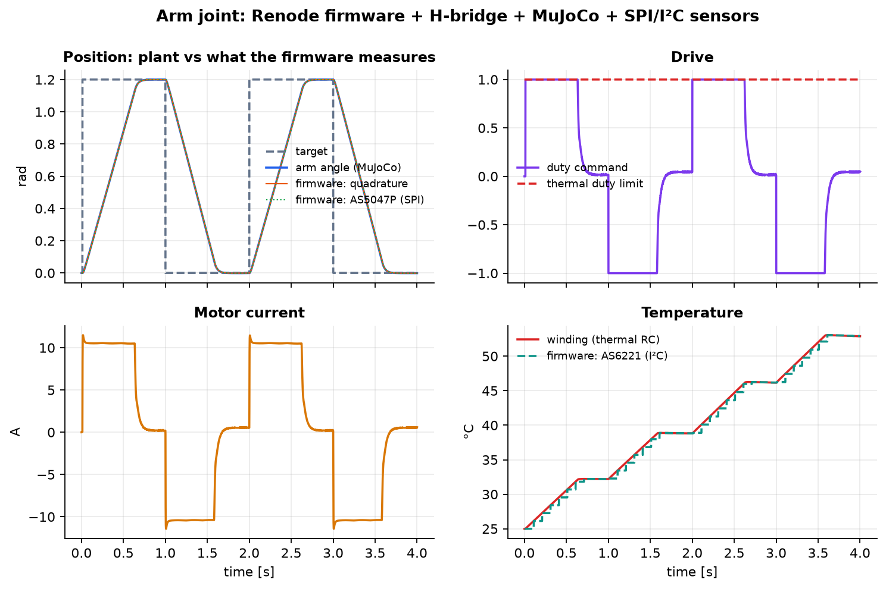

# 5 · Arm joint with SPI and I²C sensors

**Goal:** close a position loop around a MuJoCo arm with real firmware that reads an **incremental encoder** (timer), an **AS5047P absolute angle sensor over SPI** and an **AS6221 temperature sensor over I²C**, homes itself, cross-checks its sensors and derates the drive when the winding gets hot.

**You need:** Renode ≥ 1.17 (`api: message`), `mujoco`, and the firmware built with `make -C examples/mechatronics/firmware/arm-joint-l476`.

## The system



## Step 1 — gains as parameters

```yaml
parameters:
  firmware.kp: 26.7
  firmware.ki: 3.33
  firmware.kd: 0.53
```

The binding file writes these into the firmware's calibration struct in RAM every step (`sysbus` input, float32), so tuning tools can change the gains of an unmodified ELF. These values came out of [Tutorial 7](tuning.md).

## Step 2 — the encoder

```yaml
couplings:
  - {source: arm.angle, target: arm.encoder_counts, transform: {type: affine, gain: 13037.97}}   # 4096 cpr × 20 / 2π
```

and in `bindings/renode-arm-joint.yaml` a `sysbus` input writes `arm.encoder_counts` into the timer's `CNT` register. The firmware reads CNT in encoder mode exactly as on hardware, and the count is exact at every step, with no edge-rate limit.

## Step 3 — an SPI sensor modelled in Python

```yaml
      spi:
        - peripheral: sysbus.spi1.abs_encoder       # SPI.ExternalControlSPIPeripheral in the .repl
          device: as5047p
          inputs: {angle: arm.angle}
          outputs: {frames: mcu.abs_frames, errors: mcu.abs_errors}
```

The platform file puts an `ExternalControlSPIPeripheral` on SPI1. Every byte the firmware's driver clocks out becomes an event, and the `AS5047P` model answers it: 16-bit frames, even parity, answer one frame late, error flag and ERRFL register, writable zero position. The firmware verifies the parity of every answer; the model counts frames and errors so a test can check that the driver is well-behaved.

## Step 4 — an I²C sensor modelled by Renode

Renode already models the AS6221 (`Sensors.AS6221 @ i2c1 0x48`). Its temperature is set through a tiny `Python.PythonPeripheral` at `0x5F000000` that forwards a float32 written to it to `sysbus.i2c1.motor_temp.Temperature`. The project feeds it from the thermal model:

```yaml
- signal: motor.winding_temperature
  endpoint: {object: sysbus, property: sysbus, address: 0x5F000000, float32: true, direction: input}
```

## Step 5 — run

```bash
export RENODE_BIN=/path/to/renode     # 1.17 or the merged custom-cores build
embeddyn mechatronics run examples/mechatronics/mujoco-arm-firmware.yaml -o arm-fw.csv
```



Reading the four panels:

* **Position.** The MuJoCo angle, the firmware's quadrature angle and its AS5047P angle lie on top of each other. The motion is a trapezoid because the drive saturates at full duty: 0.63 s for 1.2 rad is the drive's limit, not the controller's.
* **Drive.** The duty saturates at ±1 during moves; the thermal duty limit stays at 1 because the winding stays below 70 °C.
* **Current.** ±11.5 A during moves.
* **Temperature.** The winding heats ~7 K per move. The firmware's I²C reading (every 100 ms) follows it in steps.

`lift`: overshoot 0.02 %, settling 0.63 s, steady-state error 0.2 mrad.

## Step 6 — make it fail on purpose

The tests in `tests/mechatronics/test_arm_firmware.py` do exactly this:

| Fault injected | How | Firmware reaction |
|---|---|---|
| parked away from zero | MuJoCo `initial: {"qpos:shoulder": 0.6}` | homes the incremental count to the absolute sensor after its 10 ms power-up |
| wrong encoder scale (+20 %) | coupling gain × 1.2 | encoder/absolute mismatch for 20 loops → `FAULT_ENCODER_MISMATCH`, duty limit 0 |
| hot winding (90 °C) | `ThermalRC initial_temperature: 90` | linear derating 70 → 110 °C: duty limit ≈ 0.5 |

Each is a few lines of YAML on top of the same project: firmware fault handling tested without a bench, a burnt motor or a broken encoder.

## Cost

Every SPI byte is a round trip to Python, so the 1 kHz 16-bit sensor read roughly doubles wall time (≈46 s for this 4 s run). Disable the `spi:` entry for long sweeps when the absolute sensor is not under test.

Next: several instances and FMUs in [Tutorial 6](instances-and-fmus.md).
