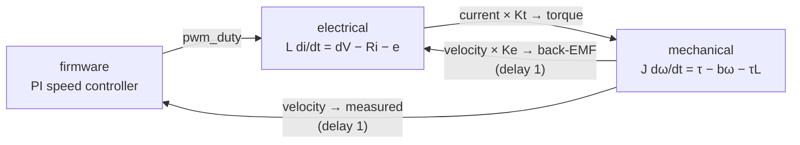
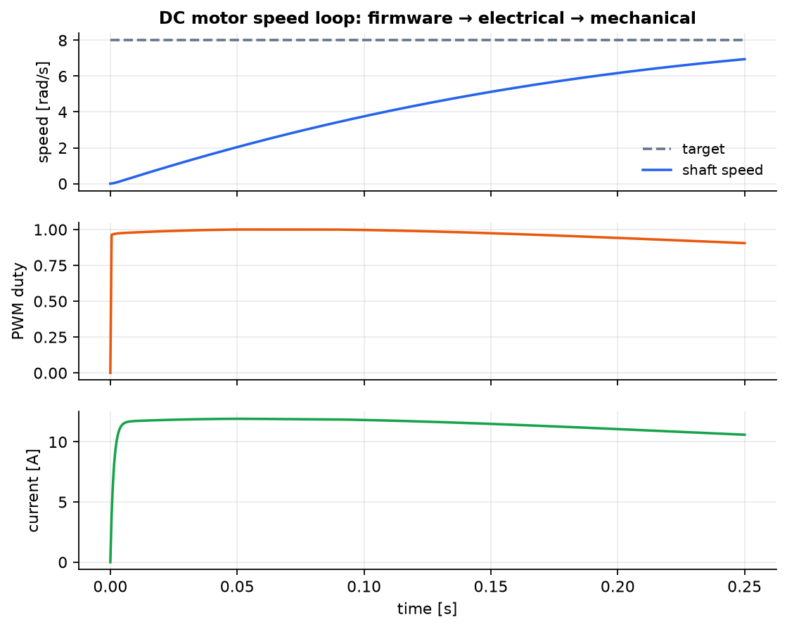

# 1 · DC motor speed loop

**Goal:** understand a complete three-domain project by reading and changing `examples/mechatronics/dc-motor.yaml`.

**You need:** the Python package. Everything runs with `--mock`.

## The system



## Step 1 — the header

```yaml
name: dc-motor-speed-control
step_seconds: 0.0005        # macro step h = 0.5 ms (2 kHz control loop)
duration_seconds: 0.25
```

## Step 2 — one simulator per domain

```yaml
simulators:
  firmware:   {options: {backend: mock, bindings: bindings/renode.yaml}}
  electrical: {model: motor.cir, options: {backend: mock}}
  mechanical: {model: worlds/dc_motor.wbt, options: {backend: mock, headless: true, bindings: bindings/webots.yaml}}
```

`backend: mock` selects the built-in models: a PI controller, an RL armature and a rotor. The `model:` and `bindings:` keys are what the *real* backends (Renode, ngspice, Webots) would use; with mocks they are ignored. Switching a domain to its real simulator is a one-word change, as [Tutorial 2](ngspice.md) shows.

## Step 3 — signals

```yaml
signals:
  firmware.target_velocity: {domain: firmware, unit: rad/s, initial: 8.0}
  firmware.pwm_duty:        {domain: firmware, initial: 0.0, min: -1.0, max: 1.0}
  electrical.supply_voltage: {domain: electrical, unit: V, initial: 24.0}
  electrical.motor_current: {domain: electrical, unit: A, initial: 0.0}
  mechanical.velocity:      {domain: mechanical, unit: rad/s, initial: 0.0}
  # ... 19 in total
```

Note `min`/`max` on the duty: whatever the controller computes, the bus clamps it to ±1.

## Step 4 — couplings

```yaml
couplings:
  - {source: firmware.pwm_duty, target: electrical.pwm_duty}
  - {source: mechanical.velocity, target: electrical.back_emf, gain: "@motor.k", delay_steps: 1}   # Ke
  - {source: electrical.motor_current, target: mechanical.motor_torque, gain: "@motor.k"}          # Kt
  - {source: mechanical.velocity, target: firmware.measured_velocity, delay_steps: 1}
```

Both electromechanical couplings use the parameter `motor.k`, declared once at the top of the file:

```yaml
parameters:
  motor.k: {value: 0.08, unit: N*m/A}   # torque constant Kt = back-EMF constant Ke (V*s/rad)
```

In SI units \(K_t\) [N·m/A] and \(K_e\) [V·s/rad] are the same number for a DC motor; one parameter keeps them so, and lets [tuning](tuning.md) or [tolerance analysis](tolerance.md) vary the motor constant.

The forward path (duty → current → torque) follows the execution order firmware → electrical → mechanical, so it needs no delay. The two feedback paths go *against* the order and carry `delay_steps: 1`: within step \(k\) they use the velocity committed at the end of step \(k-1\). See [why feedback needs a delay](../theory/master-algorithm.md#why-feedback-needs-delay_steps-1).

## Step 5 — metrics

```yaml
metrics:
  speed:   {type: step_response, signal: mechanical.velocity, target: firmware.target_velocity, settling_band: 0.02}
  current: {type: stats, signal: electrical.motor_current}
  energy:  {type: integral, signal: electrical.input_power}
```

## Step 6 — run and read

```bash
embeddyn mechatronics run examples/mechatronics/dc-motor.yaml --mock -o dc-motor.csv
```



Read the figure top to bottom: the controller saturates the duty at 1 immediately, the current jumps to ~12 A (24 V / 2 Ω limited by the 3 mH inductance), and the speed ramps. At 0.25 s it is still below 8 rad/s, so the metrics report:

```json
"speed.final_value": 6.865, "speed.rise_time": null, "speed.overshoot": 0.0, "current.peak": 11.92
```

`rise_time: null` is honest: the response never reached 90 %.

## Step 7 — experiment

=== "Longer run"

    Copy the project, set `duration_seconds: 1.0` and rerun. The speed now settles at 8 rad/s and the step-response
    metrics (`rise_time`, `settling_time`) get values.

=== "Heavier load"

    Change `mechanical.load_torque` `initial: 0.3` and rerun: the final speed drops and the current stays higher.

=== "Remove a delay"

    Delete `delay_steps: 1` from the back-EMF coupling. The result changes slightly: the electrical step now sees a back-EMF from a velocity that the mechanical step has not updated yet. The value is still one step old, but only because of the execution order. The [verification](verification.md) convergence check would show the difference shrinking with \(h\).

## What you learned

* A project is signals + couplings + instances + metrics.
* Execution order and `delay_steps` define causality in each step.
* Every run is reproducible and leaves a CSV, telemetry and a manifest.

Next: replace the ideal armature with a switching H-bridge in [Tutorial 2](ngspice.md).
