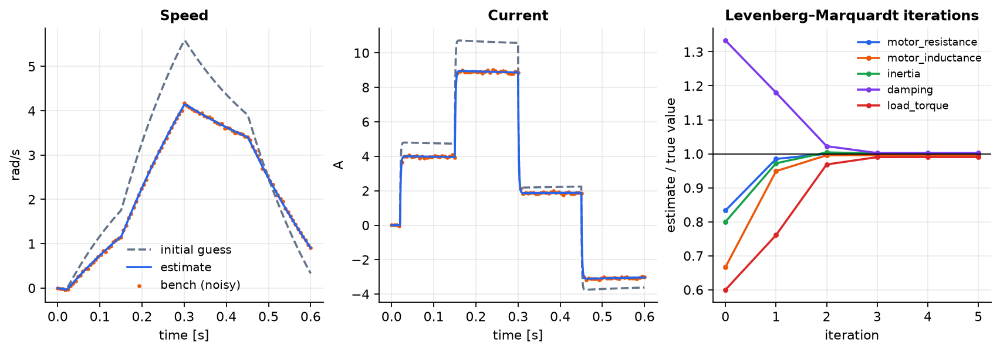

# 9 · Estimating parameters from a bench test

**Goal:** fit five physical parameters of the DC motor (resistance, inductance, inertia, damping, load torque) to a recorded open-loop step test, and judge how well each one is determined.

**You need:** the Python package. Runtime ~7 s.

## Step 1 — the recording

`examples/mechatronics/estimation/bench/dc-motor-step-test.csv` has the commanded duty and the measured current and speed at 1 kHz:

```text
time,duty,current,speed
0.0,0.0,0.028704,-0.004663
0.001,0.0,-0.03977,0.020328
...
```

It is synthetic (`make_bench_data.py` runs the model with known values and adds noise of 0.05 A and 0.02 rad/s) so the answer can be checked. With real hardware you would log the same three columns from the bench.

## Step 2 — the estimation spec

```yaml
project: ../dc-motor.yaml
measurements: bench/dc-motor-step-test.csv
disable: [firmware]                 # open loop: the recorded duty replaces the controller
replay:
  domain: firmware
  columns: {duty: firmware.pwm_duty}
  interpolation: previous
fit:
  electrical.motor_current: {column: current, sigma: 0.05}
  mechanical.velocity: {column: speed, sigma: 0.02}
parameters:                         # initial guesses = the project's nominal values
  electrical.motor_resistance: {initial: 2.0, min: 0.1, max: 20, scale: log}
  electrical.motor_inductance: {initial: 0.003, min: 0.0001, max: 0.1, scale: log}
  mechanical.inertia: {initial: 0.02, min: 0.001, max: 1, scale: log}
  mechanical.damping: {initial: 0.08, min: 0.001, max: 1, scale: log}
  mechanical.load_torque: {initial: 0.03, min: -1, max: 1}
max_iterations: 30
```

* `disable` + `replay` turn the closed-loop project into the open-loop bench experiment.
* `sigma` is the measurement noise of each channel; it weights the residuals.

## Step 3 — run

```bash
embeddyn mechatronics estimate examples/mechatronics/estimation/dc-motor.yaml -o est.json
```



The initial guess (dashed) misses the bench data badly; after five Levenberg–Marquardt iterations the model lies on top of it, and every parameter converged to its true value (right panel, ratio 1).

## Step 4 — judge the result

| Parameter | True | Estimate | 95 % interval | ±% |
|---|---|---|---|---|
| resistance [Ω] | 2.4 | 2.4003 | 2.3984 – 2.4021 | 0.08 |
| inductance [mH] | 4.5 | 4.482 | 4.428 – 4.536 | 1.2 |
| inertia [kg·m²] | 0.025 | 0.02503 | 0.02498 – 0.02507 | 0.17 |
| damping [N·m·s] | 0.06 | 0.06013 | 0.05977 – 0.06048 | 0.59 |
| load torque [N·m] | 0.05 | 0.04952 | 0.04855 – 0.05049 | 1.95 |

Every true value lies inside its interval. The reduced chi-square is **0.96**: the residuals are as large as the stated noise and no larger, so the model explains the data completely.

Look at `correlation` too: resistance and inertia have \(\rho = -0.43\), still well separated. Values near ±1 would mean this experiment cannot distinguish the two, and you would need a different stimulus (a free run-down, a locked-rotor test).

## With real data

* Expect reduced chi-square > 1: real motors have effects the model lacks (cogging, temperature drift). The intervals are scaled by it, so they stay honest.
* A parameter flagged `at_bound` has hit its min or max: widen the range or question the model.
* Feed the estimates back into the project's `parameters:` with a provenance entry (`source: estimation, run: …`).

Theory: [Parameter estimation](../theory/estimation.md).
