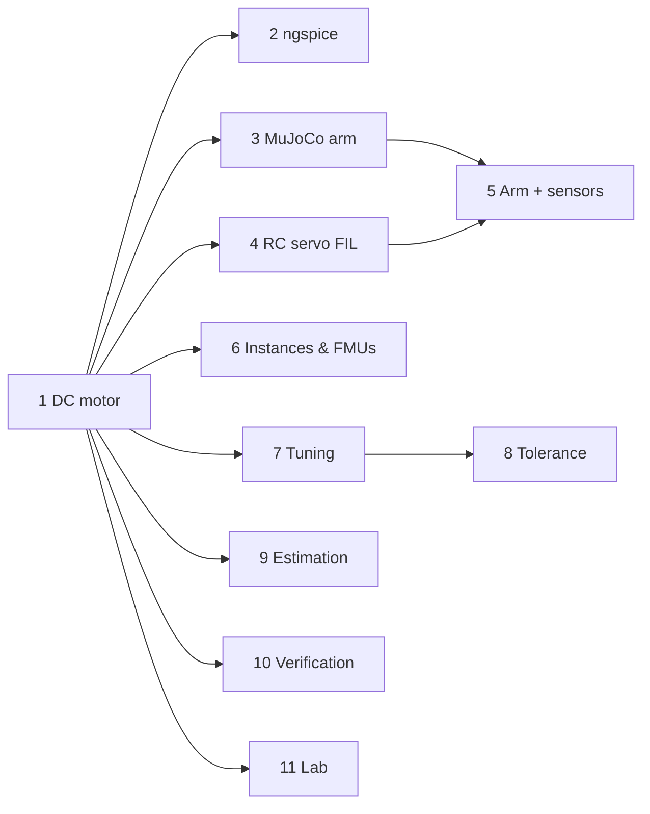

# Tutorials

Each tutorial adds one capability, using an example that ships in `examples/mechatronics/`. Run the commands from the embeddyn root. Every figure here was produced from exactly these commands.

| # | Tutorial | You learn | Needs |
|---|---|---|---|
| 1 | [DC motor speed loop](dc-motor.md) | signals, couplings, delays, metrics, run outputs | nothing (`--mock`) |
| 2 | [A switching bridge in ngspice](ngspice.md) | electrical detail without touching the rest | libngspice |
| 3 | [A robot arm in MuJoCo](mujoco-arm.md) | named instances, Python plants, multibody physics | `mujoco` |
| 4 | [Firmware in the loop: RC servo](rc-servo-firmware.md) | Renode, bindings, PWM capture, ADC | Renode |
| 5 | [Arm joint with SPI and I²C sensors](arm-joint-sensors.md) | encoders, SPI device models, sensor feeds, thermal derating | Renode ≥ 1.17, `mujoco` |
| 6 | [Several instances and FMUs](instances-and-fmus.md) | two motors on one bus, FMU import | nothing |
| 7 | [Tuning controller gains](tuning.md) | objectives, constraints, Nelder–Mead vs CMA-ES, parallel runs | nothing (Renode for the firmware part) |
| 8 | [Tolerances and yield](tolerance.md) | Monte Carlo, Sobol indices | nothing |
| 9 | [Estimating parameters](estimation.md) | replaying a bench test, confidence intervals | nothing |
| 10 | [Verifying a model](verification.md) | energy balance, convergence, golden files, scenarios | nothing |
| 11 | [Building and running in the Lab](lab.md) | the GUI: parts, wires, instruments, 3-D | nothing |

Tutorials 1–3 and 6–11 run on any machine with the Python package. 4 and 5 need Renode (see [installation](../getting-started/installation.md#external-simulators)); 5 also needs the 1.17 protocol for SPI.
