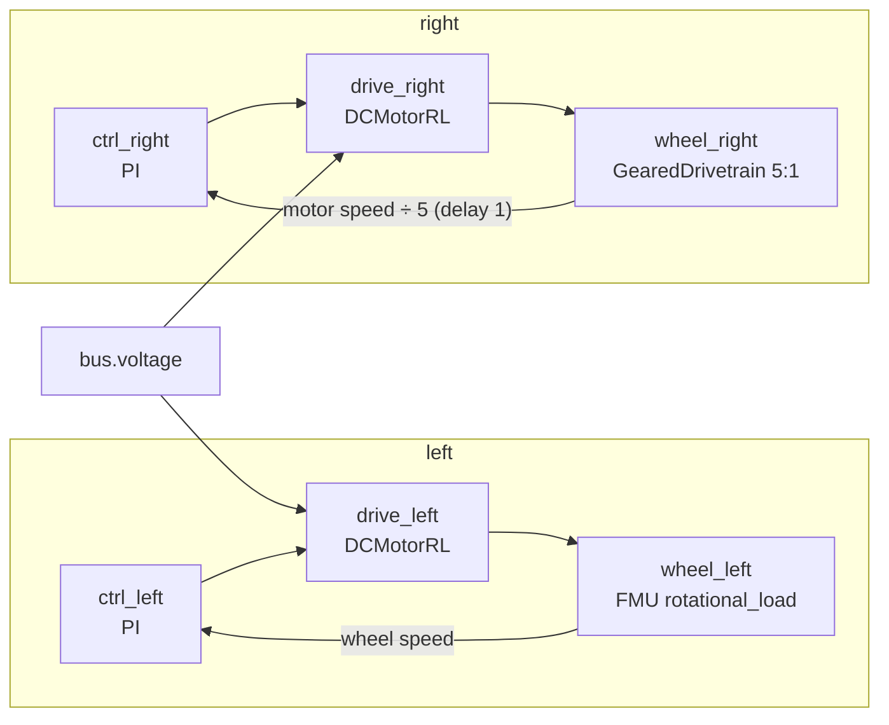
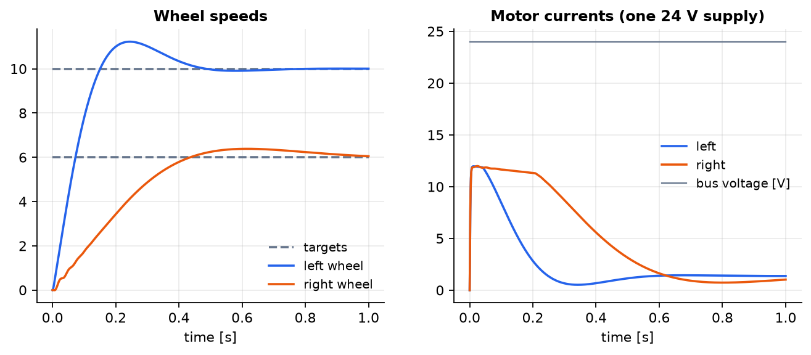

# 6 · Several instances and FMUs

**Goal:** model a differential drive with two independent speed loops: six instances, two rates, one wheel as an FMU and the other as a geared drivetrain with backlash.

**You need:** the Python package. Build the example FMU once: `python examples/mechatronics/fmus/rotational_load/build_fmu.py`.

## The system



## Step 1 — the same plant twice

Named instances let the same class appear as often as needed; each has its own parameters and wiring:

```yaml
parameters:
  left.kp: 0.15
  left.ki: 1.5
  right.kp: 0.4
  right.ki: 2.0

instances:
  ctrl_left:
    domain: firmware
    model: "embeddyn.mechatronics.plants:PIController"
    options:
      backend: python
      parameters: {kp: "@left.kp", ki: "@left.ki"}       # "@name" = project parameter
      inputs: {target: left.target_speed, measured: left.wheel_speed}
      outputs: {command: left.duty, error: left.speed_error}
  ctrl_right: { ... same class, "@right.kp" ... }
```

Referencing project parameters with `@` means tuning tools can change `left.kp` without knowing which instance uses it.

## Step 2 — two rates

```yaml
  drive_left:
    domain: electrical
    step: 0.0005          # 2 kHz, inside the 1 kHz macro step
```

The controllers run at the 1 ms macro step; motors and wheels at 0.5 ms. Any instance `step` switches the project to the multi-rate scheduler (see [multi-rate schedules](../theory/master-algorithm.md#multi-rate-schedules)).

## Step 3 — an FMU wheel

```yaml
  wheel_left:
    domain: mechanical
    step: 0.0005
    model: fmus/rotational_load.fmu
    options:
      backend: fmu
      max_step: 1.0e-4                    # 5 doStep calls per activation
      parameters: {J: 0.01, b: 0.005, coulomb: 0.01}
      inputs: {tau: left.torque, tau_load: left.load_torque}
      outputs: {w: left.wheel_speed, theta: left.wheel_angle}
```

The FMU is an FMI 2.0 co-simulation binary built from C. Nothing changes for the rest of the project; a Modelica or Simulink export plugs in the same way. Variable names are checked against `modelDescription.xml` when the project loads.

## Step 4 — a geared wheel with backlash

```yaml
  wheel_right:
    domain: mechanical
    step: 0.0005
    model: "embeddyn.mechatronics.plants:GearedDrivetrain"
    options:
      backend: python
      max_step: 2.0e-5
      parameters: {gear_ratio: 5, backlash: 0.003, shaft_stiffness: 2000, load_inertia: 0.2, coulomb_friction: 0.05, encoder_cpr: 2048}
```

The right controller measures the *motor* speed, scaled by the gear ratio:

```yaml
couplings:
  - {source: right.motor_speed, target: right.motor_speed_scaled, gain: 0.2, delay_steps: 1}
```

## Step 5 — run

```bash
embeddyn mechatronics run examples/mechatronics/two-wheel-drive.yaml -o drive.csv
```



Both wheels reach their targets (10.00 and 6.05 rad/s at 1 s). The left loop, with low gains on a light FMU wheel, overshoots by about 12 %. The right wheel is slower: it carries a heavier load through a 5:1 gear, and its first few milliseconds show small steps while the backlash gap closes.

## Step 6 — verify it

The project declares a convergence check and two scenarios:

```bash
embeddyn mechatronics verify examples/mechatronics/two-wheel-drive.yaml
```

```yaml
scenarios:
  - name: slippery-left
    signals: {left.load_torque: 0.0}
    expect: [{metric: left_speed.final_value, min: 9.8, max: 10.2}]
  - name: low-battery
    signals: {bus.voltage: 12.0}
    expect: [{metric: left_speed.final_value, min: 9.5}, {metric: right_speed.final_value, min: 5.7}]
```

## Exporting a plant as an FMU

The reverse direction works too:

```bash
pip install 'embeddyn[fmi]'
embeddyn mechatronics fmu-export embeddyn.mechatronics.plants:GearedDrivetrain -o dist/
embeddyn mechatronics fmu-check dist/GearedDrivetrain.fmu
```

See [FMI co-simulation](../theory/fmi.md).

Next: let the computer pick the gains in [Tutorial 7](tuning.md).
