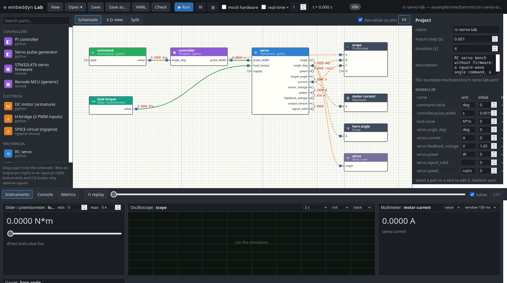
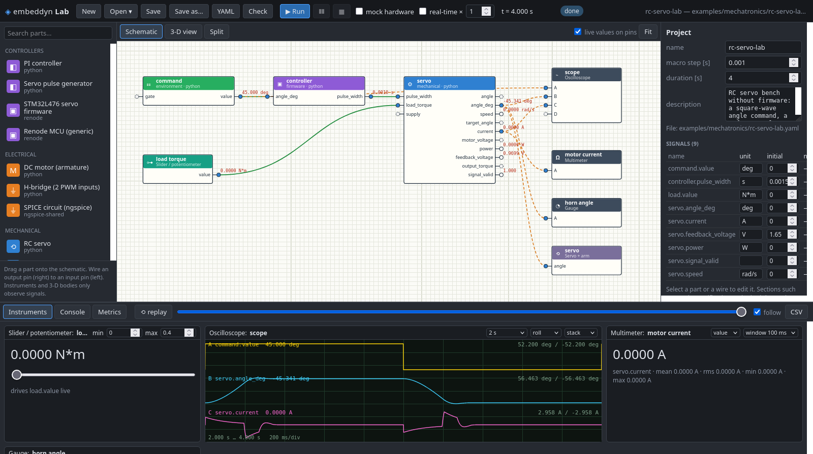
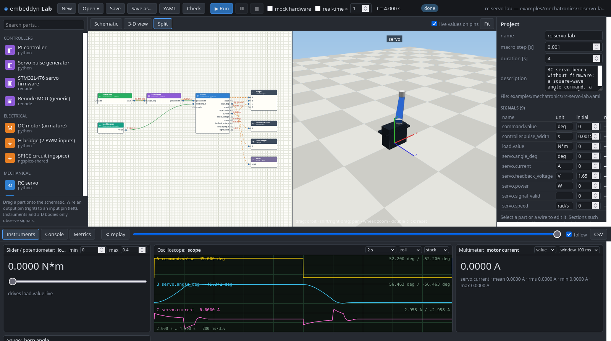
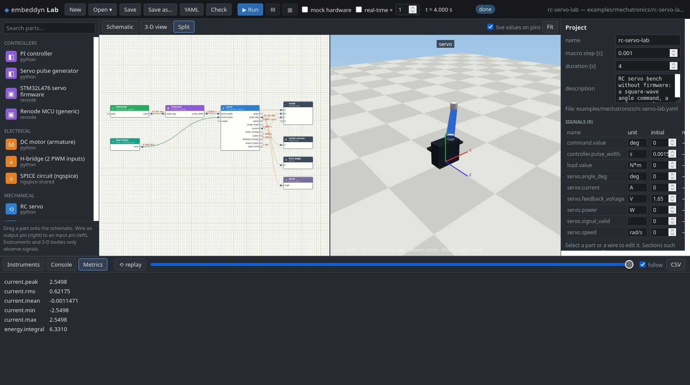
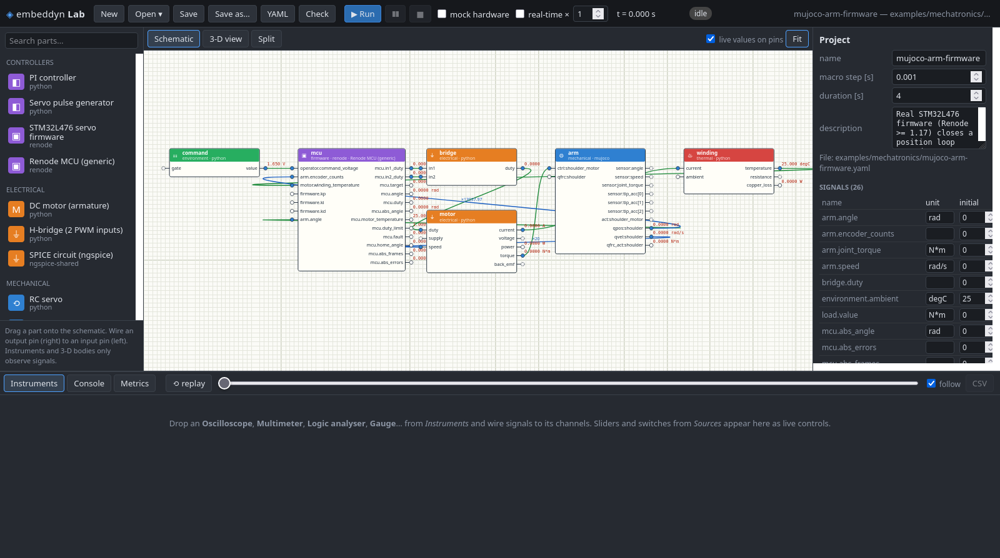

# 11 · Building and running in the Lab

**Goal:** use the Lab, embeddyn's browser GUI, to open a project, wire parts, attach instruments, run with live controls and inspect results.

**You need:** the Python package. For Renode parts, start the Lab with `RENODE_BIN` set (or tick **mock hardware**).

## Step 1 — start it

```bash
embeddyn mechatronics gui examples/mechatronics/rc-servo-lab.yaml --open
```

The server listens on `http://127.0.0.1:8710`. The window has five areas:



| Area | What it holds |
|---|---|
| toolbar | New · Open (examples and files) · Save · YAML · Check · Run/Pause/Stop · mock hardware · real-time × speed |
| parts library (left) | controllers, electrical, mechanical, sources, instruments, 3-D bodies |
| canvas (centre) | **Schematic**, **3-D view** or **Split** |
| inspector (right) | project, part or wire properties; signal table with live values |
| dock (bottom) | instruments, console, metrics, replay cursor, CSV export |

## Step 2 — read the schematic

`rc-servo-lab.yaml` is the RC servo without firmware: a square-wave **command** feeds a software **pulse generator**, which drives the **servo** plant; a **load** slider pushes on the horn. On the right, instruments are wired with dashed orange **probe** wires: they observe signals without changing the simulation.

Wire colours tell you what a wire becomes in the project file:

* **green net**: a Python/FMU/MuJoCo input reading a signal (`options.inputs`);
* **blue coupling**: a `couplings:` entry (select it to edit gain, offset, clamp, deadband, quantisation or delay);
* **orange probe**: an instrument or 3-D body watching a signal.

## Step 3 — run it

Press **▶ Run** (F5). Values appear on the pins, the scope draws command, angle and current, the meter and gauge update.



While it runs, drag the **load torque** slider: the slider *forces* `load.value` every step. The proportional servo droops under load; above the 0.48 N·m stall torque it is back-driven.

## Step 4 — the 3-D view

Switch to **Split** to see the schematic and the moving servo side by side:



The 3-D view shows the co-simulation state: bodies follow signals (here the horn angle). The physics happens in the plant, not in the renderer.

## Step 5 — metrics and replay

The **Metrics** tab shows the project's metrics for the finished run, the same numbers `embeddyn mechatronics run` prints:



Drag the **replay** cursor to scrub through the recorded run; instruments and the 3-D view follow. **CSV** downloads all signals.

## Step 6 — build something

1. **New**, then drag a **PI controller**, a **DC motor** and a **Geared drivetrain** from the library.
2. Wire the controller's `command` to the motor's `duty`, the motor's `torque` to the drivetrain's `motor_torque`, the drivetrain's `load_speed` back to the controller's `measured`.
3. Drop a **Function generator** on the controller's `target` and an **Oscilloscope** on the speed and current.
4. **Check** validates the project; **Run**.
5. **Save as…** writes an ordinary project YAML that `embeddyn mechatronics run` accepts unchanged.

## Firmware in the Lab

Open `rc-servo-l476.yaml` (Tutorial 4) or `mujoco-arm-firmware.yaml` (Tutorial 5). Renode MCU parts show their bindings as pins, SPI devices as `spi:<device>.<field>` pins, and the UART console appears in a serial monitor where you can type to the firmware.



Theory and file format: [The Lab](../theory/lab.md) · [Lab reference](../reference/lab.md).
