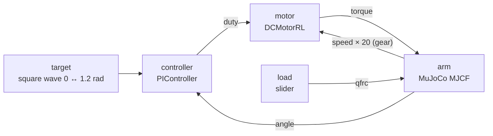
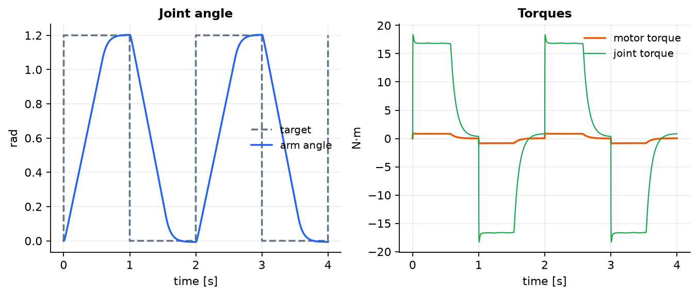
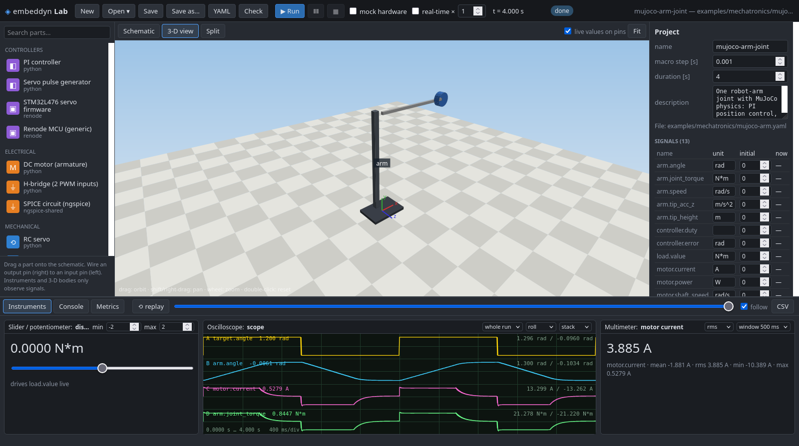

# 3 · A robot arm in MuJoCo

**Goal:** build a position-controlled robot joint from named instances: a function generator, a PI controller, a DC motor and a MuJoCo arm with gravity.

**You need:** `pip install mujoco`.

## The system



## Step 1 — named instances

`examples/mechatronics/mujoco-arm.yaml` uses `instances:` instead of one simulator per domain. Each Python instance names a plant class and wires its ports to signals:

```yaml
instances:
  target:
    domain: environment
    model: embeddyn.mechatronics.gui.sources:FunctionGenerator
    options: {backend: python, parameters: {waveform: square, amplitude: 0.6, offset: 0.6, frequency: 0.5},
              outputs: {value: target.angle}}
  controller:
    domain: firmware
    model: embeddyn.mechatronics.plants:PIController
    options:
      backend: python
      parameters: {kp: 6.0, ki: 3.0, minimum: -1.0, maximum: 1.0}
      inputs: {target: target.angle, measured: arm.angle}
      outputs: {command: controller.duty, error: controller.error}
  motor:
    domain: electrical
    model: embeddyn.mechatronics.plants:DCMotorRL
    options:
      backend: python
      max_step: 1.0e-5                     # RK4 sub-steps resolve the 1.5 ms electrical time constant
      parameters: {resistance: 2.0, inductance: 0.003, ke: 0.08, kt: 0.08}
      inputs: {duty: controller.duty, speed: motor.shaft_speed}
      outputs: {current: motor.current, torque: motor.torque, power: motor.power}
```

`inputs` of a Python instance read signals directly (a *net*); no coupling entry is needed.

## Step 2 — the MuJoCo instance

```yaml
  arm:
    domain: mechanical
    model: mujoco/arm-joint.xml
    options:
      backend: mujoco
      inputs:  {"ctrl:shoulder_motor": motor.torque, "qfrc:shoulder": load.value}
      outputs: {"qpos:shoulder": arm.angle, "qvel:shoulder": arm.speed, "qfrc_act:shoulder": arm.joint_torque,
                "xpos:tip[2]": arm.tip_height, "sensor:tip_acc[2]": arm.tip_acc_z}
```

Addresses name MJCF elements: `ctrl:<actuator>`, `qfrc:<joint>` in; `qpos`, `qvel`, `qfrc_act`, `sensor:<name>[i]`, `xpos:<body>[i]` out. The MJCF file holds a 0.25 m link with a payload, a hinge with a 20:1 `<motor>` gear and the rotor inertia in the joint's `armature`.

The gear also couples the speed back to the motor's back-EMF:

```yaml
couplings:
  - {source: arm.speed, target: motor.shaft_speed, transform: {type: affine, gain: 20.0}}
```

## Step 3 — run

```bash
embeddyn mechatronics run examples/mechatronics/mujoco-arm.yaml -o arm.csv
```



The joint torque is larger when lifting against gravity than when lowering. The `lift` metric scores the second rising step (window 2–3 s) against the 1.2 rad target.

## Step 4 — open it in the Lab

```bash
embeddyn mechatronics gui examples/mechatronics/mujoco-arm.yaml --open
```

The project carries a Lab layout (`metadata.gui`) with a scope, a current meter, a disturbance slider and a 3-D arm:



Drag the **load** slider while it runs to push on the joint and watch the PI loop recover.

## What you learned

* Named instances let you have any number of models per domain.
* Python plants are wired with `inputs`/`outputs`; MuJoCo with model addresses.
* The macro step (1 ms) must be a multiple of the MuJoCo timestep.

Next: replace the Python controller with real firmware in [Tutorial 4](rc-servo-firmware.md).
