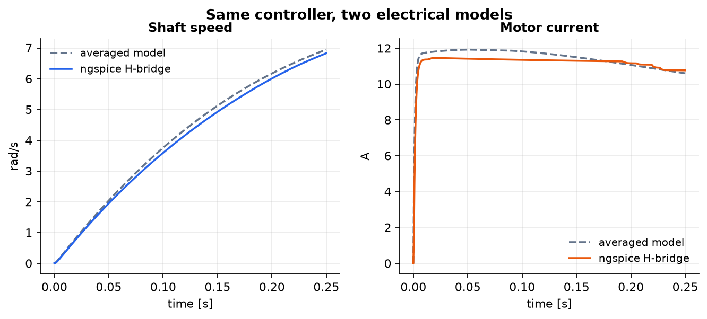

# 2 · A switching bridge in ngspice

**Goal:** replace the ideal armature of Tutorial 1 with a real 20 kHz H-bridge circuit in ngspice, without touching the controller or the mechanics.

**You need:** libngspice (`sudo apt install libngspice0`, or set `NGSPICE_LIBRARY`; see [installation](../getting-started/installation.md#external-simulators)).

## Step 1 — the only change in the project

`examples/mechatronics/dc-motor-ngspice.yaml` is Tutorial 1's project with one line different:

```yaml
simulators:
  electrical:
    model: circuits/motor-hbridge.cir
    options: {backend: ngspice-shared, bindings: bindings/ngspice-hbridge.yaml, max_step: 1.0e-6}
```

Signals, couplings, firmware and mechanics are unchanged. That is the point of signal-oriented co-simulation.

## Step 2 — the circuit

`circuits/motor-hbridge.cir` is plain SPICE: a supply with 50 mΩ source resistance and a 470 µF DC link, a triangle carrier, four voltage-controlled switches and the motor's R, L and back-EMF.

```spice
.param rmotor={{electrical.motor_resistance}}       * placeholders take the signal's initial value
Vbus vsrc 0 dc 0 external                           * driven from the co-simulation each step
Rsrc vsrc vbus 0.05
Cbus vbus 0 470u ic={{electrical.supply_voltage}}
Vtri tri 0 PULSE(0.01 0.99 0 24.995u 24.995u 10n 50u)   * 20 kHz carrier
Vdutyp dutyp 0 dc 0 external
Vdutyn dutyn 0 dc 0 external
S1 vbus a dutyp tri sw                              * leg A high side: on while duty > carrier
S2 a 0 tri dutyp sw
...
.model sw sw(vt=0 vh=0.001 ron=0.02 roff=1meg)
```

Sources that the co-simulation drives are declared `dc 0 external`. The adapter strips any `.tran`/`.control`/`.end` and runs its own transient.

## Step 3 — the bindings

```yaml
bindings:
  - {signal: electrical.pwm_duty, direction: input, source: Vdutyp, min: 0.0, max: 1.0}
  - {signal: electrical.pwm_duty, direction: input, source: Vdutyn, scale: -1.0, min: 0.0, max: 1.0}
  - {signal: electrical.supply_voltage, direction: input, source: Vbus}
  - {signal: electrical.back_emf, direction: input, source: Vbemf}
  - {signal: electrical.motor_resistance, direction: input, alter: Rmotor}
  - {signal: electrical.motor_current, direction: output, vector: "i(Vsense)", mode: mean}
  - {signal: electrical.motor_voltage, direction: output, vector: "V(a,b)", mode: mean}
```

One signed duty drives two legs: positive duty goes to leg A, negative duty (scaled by −1, clamped at 0) to leg B. Outputs use `mode: mean`, the average over the 0.5 ms step, so the 20 kHz ripple does not alias into the mechanical model ([why](../theory/electronics.md#why-mean-values-are-the-right-coupling)).

## Step 4 — run and compare

```bash
export NGSPICE_LIBRARY=/usr/lib/x86_64-linux-gnu/libngspice.so.0
embeddyn mechatronics run examples/mechatronics/dc-motor-ngspice.yaml -o hbridge.csv
```

About 250 000 SPICE points in ~4 s.



The switching bridge delivers slightly less current than the ideal model: at full duty and ~11.4 A it puts 22.97 V across the motor instead of 24 V (0.05 Ω source plus two 0.02 Ω switches), so the motor accelerates a little more slowly. The ideal model hides losses that matter when you size a supply or tune for a voltage margin.

## Step 5 — with real firmware too

`dc-motor-full.yaml` uses the same bridge with the STM32 speed-control firmware in Renode instead of the mock controller. It runs in ~11 s.

## Pitfalls worth knowing

* A triangle `PULSE` with `TR + TF = PER` (no flat top) stops the transient with "timestep too small". Give it a short `PW` (10 ns here).
* Keep the carrier inside 0…1 by more than the switch hysteresis, so duty 0 and 1 hold a switch fully off or on.
* One `ngspice-shared` instance per process (libngspice is global).

Next: multibody mechanics in [Tutorial 3](mujoco-arm.md).
