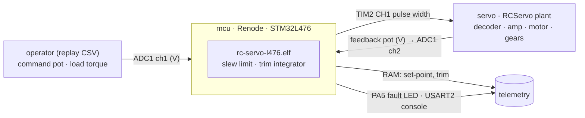
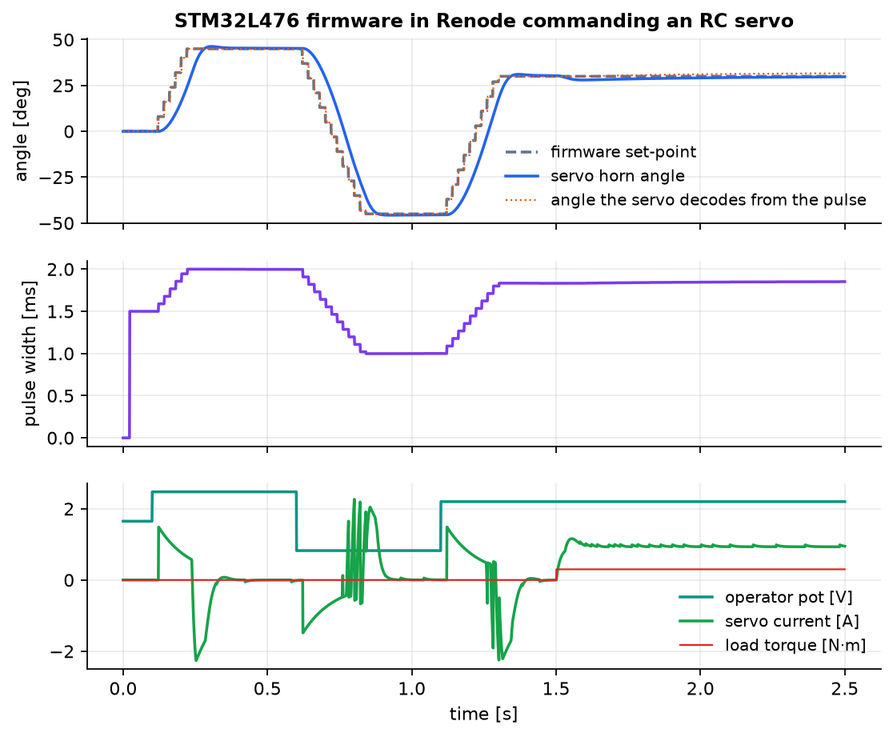

# 4 · Firmware in the loop: RC servo

**Goal:** run real STM32L476 firmware in Renode against a modelled hobby servo, and read its behaviour through pins, ADC channels and RAM, the same way a test bench would.

**You need:** Renode (`RENODE_BIN`), and `arm-none-eabi-gcc` to build the firmware.

## The system



The firmware reads a command potentiometer and the servo's feedback potentiometer on ADC1, slew-limits the set-point, trims out load droop with an outer integrator, and emits 50 Hz servo pulses on TIM2 CH1.

## Step 1 — build the firmware

```bash
make -C examples/mechatronics/firmware/rc-servo-l476
```

## Step 2 — the Renode instance

```yaml
instances:
  mcu:
    domain: firmware
    options:
      backend: renode
      launch: true                              # start Renode; false = connect to one you started
      script: renode/stm32l476-servo.resc       # creates the machine, loads the .repl and the ELF
      firmware: firmware/rc-servo-l476.elf
      machine: l476
      bindings: bindings/renode-rc-servo.yaml
      variables: {quantum: "0.00001"}          # 10 µs sync quantum = 0.9° pulse resolution
      uarts: [{name: console, peripheral: sysbus.usart2, signal: mcu.console}]
```

The `.resc` script is ordinary Renode:

```text
mach create "l476"
machine LoadPlatformDescription $ORIGIN/stm32l476-servo.repl
sysbus LoadELF $bin
emulation SetGlobalQuantum $quantum
```

## Step 3 — the bindings

`bindings/renode-rc-servo.yaml` says what the test bench is wired to:

```yaml
bindings:
  - signal: mcu.servo_pulse                     # pulse width the servo decodes
    endpoint: {object: sysbus.timer2, property: gpio_pulse_width, pin: 0, timeout: 0.05, direction: output}
  - signal: mcu.fault_led
    endpoint: {object: sysbus.gpioPortA, property: gpio_state, pin: 5, direction: output}
  - signal: mcu.setpoint_deg                    # a float in the firmware's RAM
    endpoint: {object: sysbus, property: sysbus, address: 0x2000003C, float32: true, direction: output}
  - signal: operator.command_voltage            # volts → microvolts for IADC
    endpoint: {object: sysbus.adc1, property: adc, channel: 1, scale: 1.0e6, min: 0, max: 3300000, direction: input}
  - signal: servo.feedback_voltage
    endpoint: {object: sysbus.adc1, property: adc, channel: 2, scale: 1.0e6, min: 0, max: 3300000, direction: input}
```

* `gpio_pulse_width` measures the width of each high pulse from Renode's edge time stamps and holds it, as the servo's decoder does; `timeout` turns a missing signal into 0.
* `sysbus` outputs read telemetry from a struct at a fixed RAM address. No printf, no debug probe.
* `adc` inputs set the conversion value of a channel before each step.

## Step 4 — the servo and the operator

```yaml
  servo:
    domain: mechanical
    model: "embeddyn.mechatronics.plants:RCServo"
    options:
      backend: python
      parameters: {supply: 6.0, load_inertia: 2.0e-4, coulomb_friction: 0.01}
      inputs: {pulse_width: mcu.servo_pulse, load_torque: arm.load_torque}
      outputs: {angle_deg: servo.angle_deg, feedback_voltage: servo.feedback_voltage, current: servo.current}
  operator:
    domain: environment
    model: rc-servo/command-profile.csv
    options: {backend: replay, columns: {command_voltage: operator.command_voltage, load_torque: arm.load_torque}}
```

The operator turns the command pot to +45°, −45° and +30°, and a 0.3 N·m load is applied at 1.5 s while holding +30°.

## Step 5 — run

```bash
export RENODE_BIN=/path/to/renode
embeddyn mechatronics run examples/mechatronics/rc-servo-l476.yaml -o servo.csv
```



What to look for:

* The set-point (firmware RAM) ramps in steps: the firmware's slew limiter at work.
* The pulse width moves between 1.0 and 2.0 ms; after the load step at 1.5 s it creeps up to about 1.85 ms: the firmware's trim integrator compensates the droop of the proportional servo.
* The servo current shows the load and the moves; at rest it is near zero.

| Metric | Value |
|---|---|
| `move_up.overshoot` / `settling_time` | 2.8 % / 0.169 s |
| `move_down.overshoot` / `settling_time` | 0.76 % / 0.256 s |
| `loaded_hold.mean` (target 30°) | 29.66° |

## Step 6 — talk to the firmware

The USART2 console is an **event signal** (`mcu.console`): every telemetry line the firmware prints arrives with its virtual time stamp. In the Lab, the serial monitor shows it live and can send `R` to clear a latched fault.

## Why it is slow, and when it matters

This 2.5 s run takes a few minutes, because Renode emulates every instruction and every 10 µs sync point. Use firmware-in-the-loop for what only the real firmware can show (timing, quantisation, slew limits, fault handling), and a Python controller for wide parameter sweeps. [Tuning](tuning.md) supports both, with parallel workers.

Next: SPI and I²C sensors and thermal derating in [Tutorial 5](arm-joint-sensors.md).
