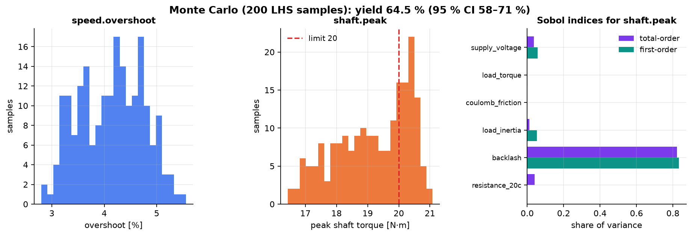

# 8 · Tolerances and yield

**Goal:** find out how many production units of the geared servo will meet spec when every part varies, and which tolerance is responsible for the failures.

**You need:** the Python package. The analysis is ~700 runs; with 4 workers it takes about 4 minutes.

## Step 1 — describe the spreads

`examples/mechatronics/tolerance/servo.yaml`:

```yaml
project: ../servo-drivetrain.yaml
duration: 1.0
seed: 1
parameters:
  motor.resistance_20c: {nominal: 2.0, tolerance: 0.05, distribution: normal}        # ±5 % = 3σ
  drivetrain.backlash: {distribution: uniform, minimum: 0.002, maximum: 0.008}      # new to worn gearbox [rad]
  drivetrain.load_inertia: {nominal: 1.2, tolerance: 0.10, distribution: uniform}
  drivetrain.coulomb_friction: {distribution: triangular, minimum: 0.15, mode: 0.25, maximum: 0.4}
  mechanical.load_torque: {distribution: uniform, minimum: 0.2, maximum: 0.4}
  electrical.supply_voltage: {distribution: normal, mean: 24.0, sigma: 0.4}
outputs: [speed.overshoot, speed.settling_time, shaft.peak, temperature.max, energy.integral]
limits:
  - {metric: speed.overshoot, max: 10.0}
  - {metric: speed.settling_time, max: 0.6}
  - {metric: shaft.peak, max: 20.0}
monte_carlo: {samples: 200, sampling: lhs}
sensitivity: {base_samples: 64, bootstrap: 200}
```

Choose distributions from what you know: datasheet ± limits as `normal` 3σ, a range with no preferred value as `uniform`, a most-likely value with hard limits as `triangular`.

## Step 2 — run

```bash
embeddyn mechatronics tolerance examples/mechatronics/tolerance/servo.yaml --workers 4 -o tol.json
```

## Step 3 — read the yield



```json
"yield": 0.645, "yield_ci95": [0.577, 0.708],
"limits": [{"metric": "speed.overshoot", "max": 10.0, "pass_rate": 1.0},
           {"metric": "speed.settling_time", "max": 0.6, "pass_rate": 1.0},
           {"metric": "shaft.peak", "max": 20.0, "pass_rate": 0.645}]
```

Overshoot and settling pass everywhere. **Peak shaft torque** fails in about a third of the units. The yield interval is a Wilson 95 % interval: with 200 samples, "64.5 %" means "somewhere between 58 % and 71 %".

## Step 4 — find the cause

The Sobol indices for `shaft.peak` (right panel) put ~0.82 of its variance on **backlash** alone, both first-order and total. Every other tolerance is below 0.06. The winding resistance and supply voltage have total indices near zero: they could be loosened without affecting this output.

So the fix is mechanical: a tighter backlash spec for the gearbox, or a controller that limits torque rate while the gap closes. A bigger motor or a better supply would not help.

## Step 5 — re-check after a change

Narrow the backlash range (e.g. `maximum: 0.005`) and rerun. The yield should rise and the backlash index fall. Because sampling is seeded, the comparison is not muddied by different random draws.

## Notes

* `failing_samples` in the result lists the first failing parameter sets: rerun one with `--parameter-overrides` to look at it in detail, or open it in the Lab.
* An output that is missing in some runs (never settles) counts as a failure for yield and is skipped for sensitivity, with a note.
* Theory: [Uncertainty and sensitivity](../theory/uncertainty.md).
