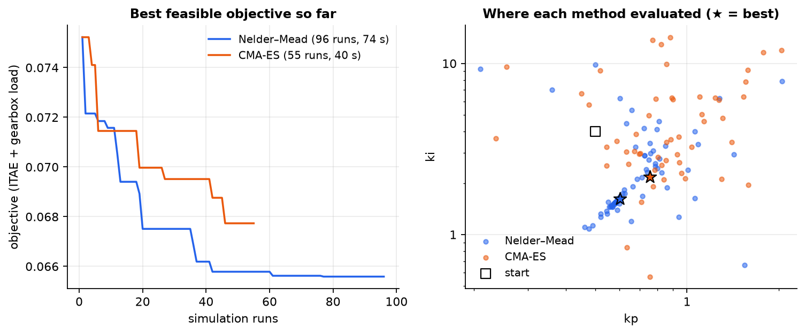
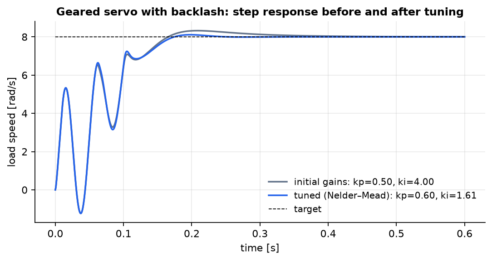

# 7 · Tuning controller gains

**Goal:** let embeddyn pick controller gains against a written-down objective, first for a Python controller in seconds, then for the real arm-joint firmware in minutes.

**You need:** the Python package; Renode ≥ 1.17 for Part B.

## Part A — a geared servo in under a minute

### Step 1 — the tuning spec

`examples/mechatronics/tuning/servo-pi.yaml` points at a project and says what to vary, what to minimise and what must hold:

```yaml
project: ../servo-drivetrain.yaml
parameters:
  controller.kp: {initial: 0.5, min: 0.02, max: 3.0, scale: log}
  controller.ki: {initial: 4.0, min: 0.1, max: 40.0, scale: log}
objective:
  - {metric: speed.itae, weight: 1.0}
  - {metric: shaft.peak, weight: 0.002}       # spare the gearbox
constraints:
  - {metric: speed.overshoot, max: 5.0}
  - {metric: speed.settling_time, max: 0.5}
max_evaluations: 30
```

* `scale: log` searches gains by ratio, the natural scale for gains.
* The objective is a weighted sum of [metric figures](../theory/metrics.md). ITAE punishes slow settling; the small `shaft.peak` term keeps the optimiser from buying speed with gearbox shock loads.
* Constraints are hard limits, enforced with a [graded penalty](../theory/optimisation.md#the-problem).

### Step 2 — run both methods

```bash
embeddyn mechatronics tune examples/mechatronics/tuning/servo-pi.yaml --method nelder-mead --workers 4 --max-evaluations 60 -o nm.json
embeddyn mechatronics tune examples/mechatronics/tuning/servo-pi.yaml --method cmaes       --workers 4 --max-evaluations 60 -o cma.json
```



| | Start | Nelder–Mead | CMA-ES |
|---|---|---|---|
| kp, ki | 0.50, 4.00 | 0.60, 1.61 | 0.76, 2.18 |
| objective | 0.0752 | **0.0656** | 0.0677 |
| overshoot | 4.1 % | 1.4 % | 1.2 % |
| settling time | 0.283 s | 0.164 s | 0.161 s |
| runs / wall time | | 96 (36 speculative) / 74 s | 55 / 40 s |

On this smooth two-parameter problem Nelder–Mead's tight simplex path wins on the objective; CMA-ES spreads its samples over the region (right panel) and stops when the budget has no room for another generation.



The first 0.1 s is the backlash rattle. The gains cannot change it, because it comes from the gearbox. What tuning removes is the slow overshoot hump after it. To attack the rattle, tune or [tolerance-analyse](tolerance.md) the drivetrain instead.

### Step 3 — read the result

`nm.json` has `initial`, `best`, `feasible` and the full `history`: every evaluation's parameters, metrics, objective and violations. Each history entry also carries `counted`: `false` marks speculative evaluations made by idle parallel workers, which are not charged to the budget.

## Part B — real firmware

`examples/mechatronics/tuning/arm-firmware.yaml` tunes the **PID gains of the unmodified STM32 firmware** from [Tutorial 5](arm-joint-sensors.md). The gains are project parameters that the bindings write into the firmware's calibration struct before every step:

```yaml
project: ../mujoco-arm-firmware.yaml
duration: 3.0                     # the `lift` step is 2.0–3.0 s
parameters:
  firmware.kp: {initial: 6.0, min: 1.0, max: 40.0, scale: log}
  firmware.ki: {initial: 3.0, min: 0.1, max: 30.0, scale: log}
  firmware.kd: {initial: 0.15, min: 0.01, max: 1.0, scale: log}
objective:
  - {metric: lift.itae, weight: 100.0}
  - {metric: energy.integral, weight: 0.01}
constraints:
  - {metric: lift.overshoot, max: 2.0}
  - {metric: lift.settling_time, max: 0.65}
```

```bash
embeddyn mechatronics tune examples/mechatronics/tuning/arm-firmware.yaml --workers 4 -o arm-nm.json
embeddyn mechatronics tune examples/mechatronics/tuning/arm-firmware-cmaes.yaml -o arm-cma.json
```

Each worker launches its own Renode on a private port with its own log.

| | Firmware defaults | Tuned (Nelder–Mead) |
|---|---|---|
| kp / ki / kd | 6 / 3 / 0.15 | 26.7 / 3.33 / 0.53 |
| settling time | 0.679 s | 0.630 s |
| overshoot | 0.35 % | 0.013 % |
| steady-state error | 3.3 mrad | 0.2 mrad |

Two lessons from this spec, recorded in its comments:

* **Know the physical floor.** 0.63 s is the drive limit: the duty is saturated during the move, so no gains settle faster with this motor and gear. A 0.6 s constraint would have been infeasible.
* **Don't constrain what tuning cannot change.** The peak current sits at 11.5–11.7 A (stall is 12 A) for any useful gains, because the duty saturates. A peak-current constraint would only add noise.

### Parallel runs and methods on real firmware

| 4 workers | Nelder–Mead (30 counted) | CMA-ES (λ = 8) |
|---|---|---|
| runs | 52 | 49 |
| within 0.1 % of final best after | 36 runs | 12 runs |
| worker utilisation | 3.0 of 4 | 3.85 of 4 |
| best objective | 13.7639 | 13.7675 |

## Tips

* Start with the method that fits: Nelder–Mead for ≤ 3 parameters, CMA-ES beyond, or when you have many workers.
* Shorten `duration:` to the window your metrics need; it is the biggest speed-up.
* Look at the `history` around the optimum: on flat optima (here kp ≳ 15 changes little) choose the most robust point, not the lowest number.
* Then check the tuned design under component spreads: [Tutorial 8](tolerance.md).
